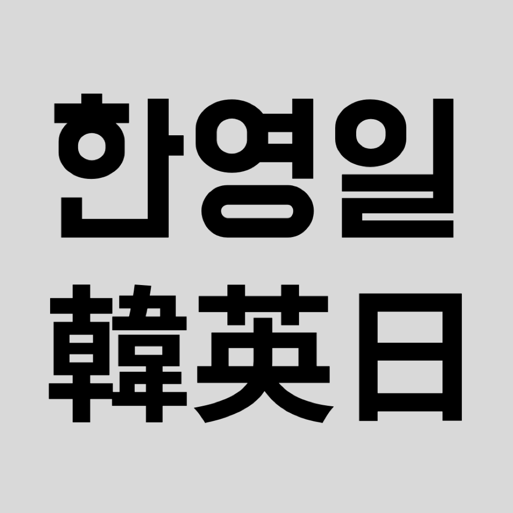

<p align="center">
  
</p>

<h1 align="center">KoEnJa</h1>

<p align="center"><b>한 자판으로 한·영·일 · 一つの配列で韓・英・日 · Korean, English, Japanese on one keyboard</b></p>

<p align="center">KoEnJa (한영일 · 韓英日) is a keyboard for typing Korean, English and Japanese without switching languages.<br>
It comes as a Mac input method, an iOS keyboard, an Android keyboard and a Windows input method.</p>

<p align="center">
  <a href="https://github.com/studioCIZMO/KoEnJa/releases/latest"></a>
  <a href="https://github.com/studioCIZMO/KoEnJa/actions/workflows/windows.yml"></a>
  
  
  
  <a href="LICENSE"></a>
</p>

<p align="center"><a href="https://cizmo.net/KoEnJa/en">Website</a> · <a href="README.md">한국어</a> · <a href="README.ja.md">日本語</a> · English</p>

<h3 align="center">No more 한/영 key, no more switching to Japanese.</h3>

<p align="center">
Type everything on the QWERTY layout.<br>
KoEnJa tells, <b>word by word</b>, whether you're typing English, Korean (Dubeolsik) or Japanese (romaji), and puts in the right letters.
</p>

```
dhsmf ghldmldptj GitHub PR flqbfmf Rmxsorh mergegoTdjdy.  →  오늘 회의에서 GitHub PR 리뷰를 끝내고 merge했어요.
Please run the tests again before you push.               →  Please run the tests again before you push.
iPhonedetesutoshimashita⏎                                 →  iPhoneでてすとしました
kinouemailwookutta⏎                                       →  きのうemailをおくった
```

<sub>These examples are taken as they are from the engine's golden test (`Android/engine/src/test/resources/golden.tsv`). ⏎ (Return) commits the kana as typed; Space converts to kanji.</sub>

<p align="center">
  <a href="https://github.com/studioCIZMO/KoEnJa/releases/latest/download/KoEnJa-Mac.zip"></a>
  <a href="https://github.com/studioCIZMO/KoEnJa/releases/latest"></a>
  <a href="https://apps.apple.com/app/id6824875642"></a>
  <a href="https://play.google.com/store/apps/details?id=com.cizmo.koenja"></a>
</p>

<p align="center">
  <a href="https://github.com/studioCIZMO/KoEnJa/releases/latest"></a><br>
  <sub>Scan with your phone to open the download page</sub>
</p>

## At a glance

- **Word by word**: it picks English, Korean or Japanese for each word, also when the language changes mid-sentence.
- **Mixed words too**: `githubdp` → `github에`, `googlede` → `googleで`, `beautywo` → `beautyを`
- **One key when it's wrong**: the switch key (the `한あA` key on iOS) puts the word in its next language. It also works right after Space committed it (`go` → `해`).
- **Language priority**: choose whether an ambiguous word goes Korean or Japanese, 한국어 우선 or 日本語優先.
- **Kanji conversion**: on Windows it works like Microsoft IME, with Space and 変換, F6–F10, and segments with Shift+←/→.
- **Three platforms, the same decisions**: the Swift (iOS), Kotlin (Android) and C++ (Windows) engines pass the same 1,950-line golden test without a single line different.
- **On the device only**: nothing you type leaves it.
- **99.4% accurate**: measured with Araso's own evaluation tools on 5,998 held-out words and phrases, Japanese on ([evaluation](#evaluation)).

## Contents

- [Why we made it](#why-we-made-it)
- [Install](#install): [Mac](#mac) · [Windows](#windows) · [iOS](#ios) · [Android](#android)
- [Keys](#keys): Mac ([language switch keys](#language-switch-keys) · [typo guesses](#typo-guesses) · [undo after commit, and learning](#undo-after-commit-and-learning) · [text replacements](#text-replacements) · [pause](#pause) · [vim](#vim)) · [Windows](#windows-1) · [iOS](#ios-1)
- [Settings](#settings) · [settings files](#settings-files)
- [How it decides](#how-it-decides) · [Evaluation](#evaluation)
- [Known limitations](#known-limitations)
- [Development](#development)
- [Privacy](#privacy)
- [KoEnJa and Araso](#koenja-and-araso)
- [Report a problem](#report-a-problem) · [Code signing policy](#code-signing-policy) · [License](#license)

## Why we made it

If you write in Korean, English and Japanese every day, you have three input sources, and you keep pressing the
switch key or typing in the wrong language. On macOS, [Araso](https://github.com/nyttastudio/araso) solved this by
telling each word's language as you type. KoEnJa uses that engine under the MIT License and is a separate product
that brings the same way of typing to iPhone, Android and Windows, where Araso doesn't run. So that every device
types with the same engine, there is also a Mac version, built from Araso's macOS input method.

## Install

### Mac

macOS 13 or later (Apple silicon, Intel). Download `KoEnJa.pkg` from the [release](https://github.com/studioCIZMO/KoEnJa/releases/latest), open it and follow the installer (since 0.3.14). Or, in Terminal:

```sh
curl -fsSL https://raw.githubusercontent.com/studioCIZMO/KoEnJa/main/Mac/get.sh | sh
```

Both install into `/Library/Input Methods` (the package asks for your administrator password as it installs, get.sh once, to make that folder; an earlier copy in `~/Library` is moved). You can also unzip `KoEnJa-Mac.zip` and move `KoEnJa.app` to `/Library/Input Methods` yourself. Then add it in System Settings → Keyboard → Input Sources → Edit… → + → Korean →
**KoEnJa** (log out and back in once if it isn't listed). The app and the package are signed with CIZMO's Developer ID and notarized by Apple.
Installed beside Araso, it keeps its settings and learned words apart (`~/Library/Application Support/KoEnJa`).
Updates come through the input menu's "Update to KoEnJa x.y.z…" or Settings → About. If you mistype one letter of a Korean word, hold right ⌥ to see corrected guesses. To have a clear typo fixed as the word ends, turn on Settings → Fix typos (off by default). The source is in `Mac/`.

<details>
<summary>Uninstall completely</summary>

The settings window's About tab → **Uninstall…** is the easy way (turn on "Also delete settings and learned words" to remove everything). In Terminal:

```sh
curl -fsSL https://raw.githubusercontent.com/studioCIZMO/KoEnJa/main/Mac/get.sh | sh -s -- --uninstall --delete-data
```

Without `--delete-data` the settings and learned words (`~/Library/Application Support/KoEnJa`) stay. Both remove `/Library/Input Methods/KoEnJa.app` (and an old `~/Library/Input Methods/KoEnJa.app`) and the package receipt, and take KoEnJa out of your input sources; macOS asks for the administrator password when it needs it.
By hand (when the settings window won't open):

```sh
killall KoEnJa 2>/dev/null
sudo rm -rf "/Library/Input Methods/KoEnJa.app" "$HOME/Library/Input Methods/KoEnJa.app"
sudo pkgutil --forget com.cizmo.inputmethod.KoEnJa.pkg
rm -rf "$HOME/Library/Application Support/KoEnJa"      # settings and learned words
defaults delete com.cizmo.inputmethod.KoEnJa 2>/dev/null  # the update check's record
killall TextInputMenuAgent 2>/dev/null
```

Then remove KoEnJa in System Settings → Keyboard → Input Sources (log out and back in once if it is still listed).
</details>

### Windows

1. Download `KoEnJa-Setup-0.3.5.exe` from [Releases](https://github.com/studioCIZMO/KoEnJa/releases/latest) and run it.
2. 0.3.5 isn't code-signed yet, so SmartScreen shows **Windows protected your PC**. Click **More info** →
   **Run anyway**, then **Yes** at the administrator prompt.
3. Leave **Open KoEnJa settings** checked on the last page and finish: pick your keyboard, your languages and the
   switch key. You can change them later in **KoEnJa 설정** in the Start menu.
4. Pick **KoEnJa** with **Win+Space**, or click the language indicator (ENG/한/あ) on the taskbar.

For 64-bit Windows 10/11 (x64) only; ARM64 Windows isn't supported yet. KoEnJa is added to your Korean and Japanese
input lists (to Korean if you have neither).

<details>
<summary>Uninstall</summary>

Settings → Apps → Installed apps → **KoEnJa** → Uninstall. It leaves your input lists too. Files in use by an open
app are removed at the next restart. Your settings and learned words (`%LOCALAPPDATA%\KoEnJa`) are kept; delete
that folder if you don't need them.

</details>

### iOS

Get it on the [App Store](https://apps.apple.com/app/id6824875642) (iOS 16 or later, free).
After installing, choose your languages and their order in the app, then add the KoEnJa keyboard in Settings →
General → Keyboard. **Allow Full Access** lets the keyboard read the language order and settings chosen in the app
and use haptics ([Privacy](#privacy)).

### Android

Get it on [Google Play](https://play.google.com/store/apps/details?id=com.cizmo.koenja) (Android 8.0 or later, free). You can also install `KoEnJa-Android-0.2.9.apk` from the [release](https://github.com/studioCIZMO/KoEnJa/releases/latest).
After installing, turn on 한영일 with 키보드 설정 열기 (open keyboard settings) in the app and pick it with 입력 방법 고르기 (choose input method); the app's screens are in Korean only for now.
The Play version is signed by Google, so to move to it from the APK, uninstall the APK first. The source is in `Android/`.

## Keys

### Mac

While a word is being typed it is underlined and shows the language KoEnJa expects.

| Key | English / Korean word | Japanese phrase |
| --- | --- | --- |
| letters | extend the word | extend the phrase (kana preview). `nn` is always `ん`, so `rennai` is れんあい and ん before the な row takes three n's (`konnnichiha`, `onnna`), as in Microsoft's and Google's Japanese input |
| letters with Caps Lock on | read as if Caps Lock were off (`GKAUS` → `하면`); English goes in in capitals (`OUTPUT`), and so do keys that would be loose jamo throughout, two or more (`RST`, `RD`, chat jamo too: `ZZ`); a word in the dictionary keeps its language. Toggled inside a word, a new word starts there | same |
| **[Language switch keys](#language-switch-keys)** (by default right ⌥ tapped on its own, and ⇧Esc) | switch reading: English → English+particle → Korean → Japanese | same (with live conversion, the kana first) |
| Right ⌥ or right ⇧ (when it is a switch key) held half a second, then let go | [typo guesses](#typo-guesses): what the word was if one key slipped | nothing |
| Esc | commit; the app gets the Esc (when chosen as a switch key, as above) | with live conversion, the kana first; on the kana, cancel the phrase (the app doesn't get it) |
| Delete | English: the last letter. Korean: the syllable being typed jamo by jamo, earlier ones whole (한국 → 한구 → 한ㄱ → 한 → gone, as the system's 2-set does) | one kana at a time (かんこく → かんこ); with live conversion the last clause goes back to kana less one, the ones before it staying as shown (今日はいい天気 → 今日はいいてん), as in macOS's Japanese input |
| **Space** | commit, then a space | **convert to kanji** (candidate window) |
| `, . ? !` and other symbols | commit, then the key | join the phrase, full-width: 、。？！ （）＿ 「」(`[ ]`) ・(`/`) 〜(`~`) |
| `-` | commit, then `-` | ー |
| Return | commit only (press again for a newline or to send; a setting) | commit as shown, kana or live-converted kanji (no newline) |
| ⌃K / F7, ⌃J / F6 | (the app's shortcut) | katakana / hiragana (Space flips, Return commits) |
| Tab, arrows, ⌘/⌃/⌥ | commit, the app gets the key (⌘ commits the moment it goes down, so ⌘V pastes after the word and a delete on ⌘⌫ doesn't skip it) | same |
| **Right ⌘** (tapped on its own; a setting) | [pause](#pause) / resume KoEnJa in this text field | same |

<details>
<summary>While converting (candidate window open)</summary>

| Key | Effect |
| --- | --- |
| Space / ↓, ↑ | next / previous candidate |
| ←, → | shorten / lengthen the first clause (`今日は｜いいてんき`) |
| 1–9 | commit that candidate of the page shown |
| Return | commit the selected candidate |
| Esc | back to the kana |
| Delete | as in macOS's Japanese input: without live conversion, commit the conversion shown less its last character (変換 → 変); with it, back to typing the phrase, its last clause as kana less one (今日はいい天気 → 今日はいいてん) |
| letters, punctuation | commit, then keep typing |

Conversion goes clause by clause. The clause the candidates are for is underlined thick and the rest
of the reading thin, so you see where ←/→ put the boundary (apps that ignore underline styles show one
line). A candidate that covers only the start of the reading (`今日は`
for きょうはいいてんきですね) commits that part and keeps converting the rest. The candidate window lists
every homophone the engine has, rare kanji toward the end (`硝` for しょう). It drops down under the clause
on the switch key strip's paper, each candidate starting where the clause does, the current one in the
same blue capsule: nine to a page, numbered, with the reading and the page under them (`きょうは · 1/2`),
the tenth candidate bringing the next page up. It is as wide as the longest candidate on any page, so
turning a page moves nothing, and near the bottom of the screen it opens above the clause. A click
chooses one too.

</details>

<details>
<summary>Symbols and numbers after Japanese</summary>

A symbol typed on its own after Japanese is full-width and stays underlined, as in a Japanese IME
(`！`, `＿`, `「`).

- Return confirms it (no newline), Space offers its other forms (`!`, `‼︎`, `『`…), and a letter
  confirms it and starts a new word.
- Inside numbers (`3.5`, `10:30`) it stays half-width, and a bracket opened full-width closes
  full-width even after an English word (`日本語（English）`).

With Japanese on, numbers and symbols can be Japanese too.

- Typed on their own at the start of a sentence or after Korean or English, they go in half-width,
  but a language switch key right after them turns them into their Japanese form, underlined
  (`123` → `１２３`, `[` → `「`, `?` → `？`).
- In Japanese text, a word typed straight after a number reads as a counter, and Space converts it
  together with the number (`3ji` → `3時`, `5fun` → `5分`). Units that aren't romaji, like `5km` or
  `3pm`, stay English.

</details>

#### Language switch keys

Choose the keys that switch readings in the settings window's **Keys** pane, keycaps you click:
right ⌥ tapped alone, ⌥Space, right ⇧ tapped alone, Esc and ⇧Esc, as many as you like. By default
they are **right ⌥ tapped alone** and **⇧Esc**. A key not chosen goes to the app.

Pressing one shows the word's readings in a vertical strip under it (`dkssud`, then `안녕`, a row each); ↓ and ↑ move to the next and the one before. The reading on
screen sits in a blue capsule like the one macOS shows under the caret when you switch input sources,
and the others sit beside it as they would go in, so you see what more presses bring; any other key puts
the strip away at once. The readings are numbered: a digit or a click picks one, as in the candidate
window, confirming the word being typed that way (as Return does, no space after it; a switch key still
changes it) or switching the word just committed to it. On 3-set the digit keys are jamo, so the word
being typed gets no numbers. Long readings are cut at 140 pt, and
near the bottom of the screen the strip shows above the word. The motion is over within 0.2 s, and there
is none with Reduce motion on in System Settings.

- **Right ⌥ or right ⇧ tapped alone**: apps don't react to a lone modifier, so it never closes a
  window or clears input. A tap with other modifiers isn't taken, so a key remapped as a Hyper key
  (⌃⌥⇧⌘ at once, by Raycast or Karabiner) keeps doing what it's bound to; choose another key then.
- **⌥Space**: it otherwise types a no-break space, which it no longer does once chosen.
- **Esc**: quick if you're used to it. But Chromium-based apps such as Claude's desktop app or Slack
  also see an Esc the input method took, so they may close their window or cancel the input while
  the word changes. With nothing to change, Esc goes to the app.
- **⇧Esc**: with nothing to change, it does nothing and never reaches the app.

The per-app settings can choose other keys for one app: switch with Esc by default, say, and leave
Esc out where it has to reach the app, as in an editor. The input menu's "Esc Switches Language"
adds or removes only Esc for the app in front. In the Japanese candidate window, and with live
conversion while kanji are shown, Esc goes back to the kana first whatever keys are chosen; on a
phrase live conversion leaves as kana (`たけ`), a switch key switches at once.

#### Typo guesses

Typing fast, one key slips: two neighbouring keys swap, a key is missed or pressed twice, Shift comes late, or
the next key is hit. Composed as Hangul, that leaves loose jamo (`clekkr` → `치다ㅏㄱ`) or other syllables
(`djddj` → `엉어`).

- **Hold right ⌥ (or right ⇧, when it is a switch key) for half a second, then let go** (Esc, ⇧Esc and ⌥Space don't open the guesses when held): the words one slip away from the word just
  committed (or being typed) are listed like kanji candidates, the first put in its place (`엉어` → `영어`). While you hold, a red wave draws under the word to show when to let go; what each guess changed is colored with a wavy underline. Hold
  again or ↓·↑ for another, a digit, a click or Return to pick one; Esc and Delete put the word back. Any other key
  keeps what is shown and goes on. With nothing to guess, "No guesses" shows for a moment. 2-set only, one slip only.
  In macOS Terminal the guess stays underlined while the list is open and goes in when you pick it. Outside a shell prompt, as in `cat`, replacing a word after Space can look broken on screen, though the line itself is right.
  Where an app doesn't let KoEnJa read the text, such as Ghostty, only a word still being typed gets guesses; a word after Space (also one `holdSpace` kept underlined) can't be replaced, so "No guesses" shows.
- **Fix typos** (Settings → Keys, `fixSlips`, off by default): where it is clear, the word is fixed as it ends
  (Space, punctuation) and "✦ Typo fixed" shows for a moment (`clekkr` → `치다가`). Only when the keys as typed
  leave loose jamo or a syllable nobody types (a word of syllables only, only for Shift on a final: `햇어요` → `했어요`), don't
  look English, don't end in chat jamo (`고마워ㅠ`), and the first guess is far more common than any other. Not
  inside URLs and paths, in Strict apps, for keys the dictionary knows, or for a word switched with a switch key.
- **Delete** right after a fix puts the word back as typed, the space kept. Left so (the next word typed, or
  switched to another reading), the keys go into the dictionary and aren't fixed again; deleted further, nothing is
  learned. A fix left in place teaches nothing.
- Picking a guess for keys the dictionary remembers forgets them ("Reset"): they are fixed again.

#### Undo after commit, and learning

Right after a word is committed with Space or punctuation (or only confirmed with Return), a language switch key switches it to its
next reading, and pressing it again keeps cycling. More symbols, digits and a space after the punctuation
(`world. `, `world?! `, `안녕.12`) or deleting the space or punctuation first keep that chance; any other key ends it. This needs the caret still right after the word, and an app that
lets KoEnJa read the text there. Right after such a switch the strip is numbered, and a digit picks that
reading and closes it, as a click in the strip does; Return keeps the reading shown and closes it, with no new line; ←/→ then move the caret (a digit typed without a switch goes in as usual).

A word earlier in the line can be fixed too. Put the caret anywhere in it (click, ⌥←, ⌥→) and tap
right ⌥ (or ⇧Esc, or ⌥Space if chosen): that word alone is underlined again, read the next way,
the caret at its end; the words after it stay as they are. The field's first word too: macOS text
views put marked text at the caret, so the caret is moved to the word's start, and at the field's
start a zero-width space stands in for the character before it until the fix ends. Tapping again keeps cycling, and as in
Japanese conversion the thick underline is the part being fixed: → makes it a key longer, taking in
the next word past the end of one (`dkssud gktpdy` → `안녕 하세요`, the underline growing with it); ← makes it shorter, and a cut
inside a word leaves the rest of its keys to be read on their own (`hellofmf` → `hello` + `를`). A word ← gives
back reads as it was but keeps a thin underline.
The strip under it follows, listing the readings of the part being fixed, numbered: a digit or a click
picks that reading and goes on as Return does, as in the candidate window: a cut front part settles
and the rest is fixed next, else the fix is done. Return on such a front
part settles it and goes on with the rest. ⇧←/⇧→ move the part's start (by whole syllables in Korean and kana in Japanese), what is
left before it staying as it went in, so not into a mixed word's Korean half or into kanji; ←/→ then stop only where what is left after it is as it went in too; with ← only the middle of a word changes (`hellodkssudworld`,
⇧→ five times and ← five times → `hello` | `안녕` | `world`). The start moves inside the first word only:
to fix the word before it too, start on that word and grow with →. The word being
typed can be cut the same way: after a switch key changed its reading ←/→ do it at once, before that
⇧← starts it, a key cut (`helloab`, ⇧←← → `hello` | `ab`; ← before a switch puts the word in and moves the caret, as
before). A whole word fixed as Japanese opens the candidate window on Space, chosen as for a word
being typed (Space and ↑/↓ for candidates, ←/→ resize the clause, Return or a digit picks and ends
the fix, Esc goes back to the kana). A word just committed with Space or Return becomes such a fix too
when ← or → follows a switch key that changed it (→ only when the word ends the line; before a switch, ⌥← to its start, then the switch key). Return or any other key puts the
fix in and takes the caret back to the end of the line (⌘Z takes two: one selects the rest of the
line, the next puts the fix back). When the fix was of the line's last word, whole (not cut), a switch key right after
changes it again, as it does a word just committed. Esc (where it isn't a switch key) and Delete
put it back as it was before anything was touched: a word being typed is typed again, read as before
the switch; a word just committed goes back to how it went in, and a switch key changes it again. The
underline covers the word alone, not the space or symbol after it (except 3-set's symbols, which a
switch changes, and where the caret's place makes it go with the word: a comma and a space right after a commit). A whole word fixed
is learned as a correction right after the commit is; a cut word isn't. Words before a
Return can't be fixed, nor words changed by hand since.

A word corrected once leans that way from then on: a close call (`so`/`내`) turns, a clear one
doesn't, so a stray switch doesn't do much. It is forgotten after 30 days unless corrected or typed
that way again. Correct the same keys the same way a second time and KoEnJa always writes them so, also with a
particle after them (remember `ghostty` and you get `ghostty에`);
switching a word back to KoEnJa's own guess forgets it, and switching a remembered word to yet another
reading moves the memory there the second time. In the switch
key's strip, a check (✓) after a reading marks the one the dictionary remembers (corrected twice, or a
word you added yourself), a pencil (✎) one corrected once. The key after a correction shrinks the strip
itself into the chosen reading's capsule, under the word's first letter, which says what happened for a
moment: a pencil and **Noted** after the first correction, the check drawing itself and **Learned**
when the word is learned, an arrow back (↺) and **Reset** on gray when switching back to KoEnJa's pick
forgot it. When nothing changed, the strip just closes.
To tell whether a word went in because of the dictionary, open **Changed by the Dictionary** in the
input menu: it lists the last five words the dictionary decided, as `ghostty → English`, and choosing
one forgets it (the list is kept only until the input method restarts, and never saved). If a word
stuck by mistake, choose **Undo Last Learned** in the
input menu. Long tokens (over 20 keys, such as a
sentence switched as one) aren't remembered.

<details>
<summary>In apps where that can't work: hold the word after Space or punctuation</summary>

In an app that doesn't let KoEnJa read the text, such as a terminal, turn on **Hold the word after
Space or punctuation** for that app (the input menu, or Apps in the settings window; `holdSpace` in
`apps.json`). Space or a punctuation mark (any symbol such as `. , ? !`, not digits) then doesn't
end the word but goes inside the underline too.

- While underlined it is the word being typed: a language switch key changes it (`dkssud.` →
  `안녕.`, the mark stays as typed), and Delete deletes (the space or mark first).
- Starting the next word puts it in with that character. So does pressing ⌘ (as it does for any
  underlined word in any app), so a ⌘V pastes after the word and a ⌘⌫ doesn't skip it to delete the text
  before (a terminal acts on ⌘V and ⌘⌫ itself, without showing KoEnJa the key); after that a switch
  key can't change the word any more.
- Only one character is held: after `안녕.` a Space or a second mark ends the word and is handled as
  with holding off (to the app, usually; after a word that went in as Japanese, by the rules for
  symbols after Japanese text).
- Return only confirms it, as on any underlined word (`returnConfirmsOnly`, on by default), so press it
  again for a new line or to run a command; with that setting off, the first Return runs the command.
- The app never gets the Space key, so its text replacements don't fire.

</details>

#### Text replacements

A shortcut in System Settings → Keyboard → Text Replacements that reads as Korean or Japanese
(`주소`, `ㅈㅅ`, `よろ`) shows in that language whatever the guess, so the app replaces it on Space as
it does with the system's input. English shortcuts are decided as usual.

- A Japanese shortcut's phrase is the first candidate on Space, and a shortcut entered more than
  once offers every phrase in turn. Enter a Japanese shortcut as its hiragana reading (`よろ`, `ぐー`).
- A Korean or English shortcut entered more than once (two phrases or more) offers them in the
  same candidate window on Space, then the shortcut as typed: the one chosen goes in with the
  space, and Esc goes back to the shortcut. With one phrase the app replaces it as before (macOS
  hands apps one phrase per shortcut).
- The app does the replacing, so apps without text replacement (terminals, Chrome…) only get the
  phrases chosen in the candidate window.
- Edits to the list apply the next time a text field becomes active.

#### Pause

Where every key is a command, like lazygit or htop in a terminal, tap **right ⌘** on its own. The
word in progress goes in, and in that text field keys go through as typed. Tap again, move to
another app or text field, or change a setting, to resume.

Each tap shows 한 under the caret for a moment, like the input source indicator,
struck through on gray when paused. The menu bar icon doesn't change, so to check later, look for the tick
in the input menu.

Change the pause key under **Keys** in the settings window: right ⌘, ⌥, ⇧ or ⌃ tapped on its own, a
recorded shortcut (one with ⌘, ⌃ or ⌥, like ⌃⌥P, or a function key alone), or none. A key that
switches languages (right ⌥ or ⇧, ⌥Space) or types kana (⌃J, ⌃K, F6, F7) can't be chosen. A
shortcut the app also has in its menus may reach the app first.

#### vim

For neovim put [`Mac/vim/koenja.lua`](Mac/vim/koenja.lua) in `~/.config/nvim/plugin/`;
for Vim (8.2 or later, `+job`) put [`Mac/vim/koenja.vim`](Mac/vim/koenja.vim) in
`~/.vim/plugin/`.

Vim then tells KoEnJa on every mode change, so words are decided only in insert mode, and in
normal, visual and command-line mode keys go straight to vim: `s`, `dd`, `ciw` and `:wq⏎` run key
by key. Inside vim, Esc always goes to vim, so no per-app setting is needed. Once vim quits, words
are decided again at the shell.

<details>
<summary>How it works, and caveats</summary>

- The signal is `KoEnJa --vim insert|normal|off --app <bundle id>`, sent on mode changes
  (entering and leaving insert mode, start, quit, focus), not on keys.
- The bundle identifier is `$__CFBundleIdentifier`, which macOS sets for every app, so nothing
  needs setting up per terminal (Ghostty, Terminal, iTerm2, VS Code…), and the signal reaches only
  that app's text field. A signal without `--app` is taken only where Esc isn't a switch key.
- Attached to tmux from a different terminal than the one that started its server, the bundle
  identifiers differ and the signal is ignored.
- If Vim doesn't see the terminal's focus changes, KoEnJa can't tell when you move from its pane
  to a shell pane; press ⇧Esc there (when it's a switch key) to start deciding words again.

</details>

### Windows

| Key | What it does |
| --- | --- |
| Switch key (while typing) | Puts the word being typed in its next language. |
| Switch key (nothing being typed) | With all three languages, switches which goes first (**한국어 우선 ↔ 日本語優先**). With only 한국어 + English or 日本語 + English, turns KoEnJa off and on (off is plain English). |
| Space · 変換 | Converts Japanese to kanji. Press again to open the candidate list. |
| Space · Tab · ↓ / Shift+Space · ↑ | Next / previous candidate in the list; PageDown and PageUp by pages. |
| 1–9 | Picks a candidate from the list. |
| Return | Commits everything. Before converting, commits the kana as typed. |
| Esc · Backspace | Cancels the conversion, back to kana. |
| Shift+← / Shift+→ | Makes the first segment shorter or longer. → commits the first segment and converts the rest. |
| F6 · F7 · 無変換 | Hiragana · katakana · flip between them |
| F8 · F9 · F10 | Half-width katakana · full-width romaji · half-width romaji |
| 半角/全角 (Japanese keyboard) | KoEnJa off and on |

**The default switch key** is right Alt tapped alone (= 한/영) on Korean and US keyboards, and 無変換 on Japanese
(JIS) keyboards. In KoEnJa Settings you can choose left Ctrl tapped alone, 한/영, 変換, 無変換, Ctrl+Shift,
Shift+Space or Ctrl+Space instead. For Ctrl+Shift, turn off Windows' Ctrl+Shift keyboard layout hotkey
(Settings > Time & language > Typing > Advanced keyboard settings > Input language hot keys).

### iOS

- **The `한あA` key** puts the current word in its next language. Right after Space, it changes the word just committed.
- You choose your languages and their order in the app. The first one takes an ambiguous word.
- While you type Japanese, the candidate bar shows conversions; after a commit it shows what usually comes next.
- **Suggestions & Correction** (in the app's settings): turn off suggestions, autocorrect, edge-touch correction or next-word prediction one by one. A feature that is off isn't computed, so typing gets lighter.

## Settings

These are the Mac input method's settings (iOS, Android and Windows have their own settings screens). From the input menu (the menu bar, while 한영일 is selected) you can:

- pause KoEnJa in this text field (like the pause key)
- turn word conversion on or off for the app in front, set its conversion threshold
  (Normal/Strict), whether Esc switches languages, whether the word is held after Space or
  punctuation and whether Japanese is on in it, or drop its settings. Those are greyed while
  conversion is off
- turn Japanese Input (the default, for every app without its own) and Live Conversion on or off
- undo the last learned word, see and forget the words the dictionary changed lately, and open Try
  Typing, the dictionary or the settings window

The settings window has these panes, and changes apply at once.

| Pane | What's there |
| --- | --- |
| Languages | converting words on or off, Japanese on or off, the Layouts card (Hangul: 2-set, 3-set final, 3-set 390; English and romaji: QWERTY, Colemak, Colemak-DH), Japanese input and its options, resetting the kanji candidate order |
| Keys | the language switch keys, Return, the pause key |
| Apps | how sure a word must be to convert (Normal, Strict) and per-app behavior: Japanese, switch keys, after Space / punctuation (`apps.json`) |
| Dictionary | words you added and words learned, in one list (`dictionary.json`): **+** to type keys and pick their reading (English, Korean, Japanese) and app; from a row's ⋯, keep a learned word for good or remove it. A word corrected once shows how long until it's forgotten |
| Try Typing | how each word was decided, with scores, and adding its keys to the dictionary |
| About | version, what changed, updates, uninstall |

### Settings files

The menu and the settings window both write JSON files in `~/Library/Application Support/KoEnJa/`.
You can edit them by hand; missing keys, and values of the wrong type (`"true"` in quotes), keep the
default. A file that isn't readable JSON is moved aside, such as to `settings.json.unreadable`,
rather than written over (`apps.json` and `dictionary.json` too). After editing these files by hand,
restart the input method: `pkill -x KoEnJa`.

<details>
<summary><code>settings.json</code>: global settings</summary>

```json
{ "japanese": true, "liveConversion": true }
```

| Key | Default | What it does |
| --- | --- | --- |
| `japanese` | **off** | Detect romaji Japanese and convert it. |
| `liveConversion` | off | While you type a Japanese phrase, show its top kanji candidate (`今日はいい天気でs`); Return commits it as shown. Like macOS Live Conversion. |
| `returnConfirmsOnly` | on | Return on an underlined word only confirms it. Off, the app gets that Return too (a Japanese phrase is still only confirmed). |
| `fixSlips` | off | A word one slipped key away from a Korean word, which can't be Korean as typed, goes in as that word at its end ([typo guesses](#typo-guesses)). Delete right after undoes it. |
| `pauseKey` | `"rightCommand"` | The pause key (see [Pause](#pause)): `"rightCommand"`, `"rightOption"`, `"rightShift"` or `"rightControl"` tapped alone, `"off"`, or a shortcut such as `{ "keyCode": 35, "modifiers": ["control", "option"], "key": "P" }`. The older `"rightCommandPause": false` reads as `"off"`. |
| `fullWidthDigits` | off | Numbers after Japanese come out full-width (`１２３`, `０３－１２３４` in addresses and phone numbers), underlined, with Space offering `123` (half-width) or conversions like `三月`. |
| `fullWidthSpace` | off | Space after Japanese types a full-width space (`　`). ⇧Space types the other width (full-width while this is off). |
| `latinLayout` | `"qwerty"` | The layout English and romaji are typed on; also `"colemak"` or `"colemakDH"`. Korean stays on its usual keys (QWERTY's) whatever the layout. Words learned on one layout are learned again on another: their keys differ. |
| `japaneseLayout` | none | The layout romaji is typed on (`"qwerty"`, `"colemak"`, `"colemakDH"`); without it, `latinLayout`'s. English on Colemak with romaji on QWERTY, for one. |
| `koreanLayout` | `"dubeolsik"` | The Korean layout; `"sebeolsikFinal"` is 3-set final (세벌식 최종), `"sebeolsik390"` 3-set 390 (세벌식 390). Jamo on digit and symbol keys (ㅆ of 갔 on 2, ㅂ of 밥 on ;) read as jamo inside a word where they fit, and as the symbol where they don't (the ! of 안녕!). Digits alone stay a number, except 00 after Korean, which is ㅋㅋ (other ㅋㅋ and ㅠㅠ (55) take a switch key). Keys that type a digit or symbol on 3-set (on 최종 ⇧B ?, ⇧/ !, ⇧H 0, [ (; on 390 ⇧B !, ⇧M 1) type 3-set's straight after a Korean word and in the symbols that follow it, and QWERTY's anywhere else (Bob); a switch key right after takes them back to the keys as typed (지냈어? → ldhr2jtB). |
| `japaneseEngine` | `"apple"` | Kanji conversion: `"apple"` uses the engine of macOS's Japanese input, `"azooKey"` the AzooKey converter in the app. |
| `checkForUpdates` | on | Once a day, ask GitHub for the latest release's version (nothing else is sent), and say so in the input menu and About when it is newer. |
| `displayLanguage` | none | The language of the settings window and the input menu (`"en"`, `"ko"`); without it, the system's. |

With live conversion:

- Space opens the candidate window at the next candidate. With the kana still on screen (`しょう`),
  it opens at the first conversion (`翔`).
- Esc shows the kana. Esc again switches language where Esc is a switch key, else cancels the phrase,
  as macOS's Japanese input does (the app doesn't get it).
- Short readings only change into kanji (`と` stays `と`, `私` converts).
- The top candidate is right for about 4 in 5 short phrases and 3 in 4 whole sentences
  ([held-out results](#evaluation)), so glance before Return. Conversion takes 8–21 ms a
  keystroke.

</details>

<details>
<summary><code>apps.json</code>: per-app behavior</summary>

`"*"` is your default for every app; an app (by bundle identifier) names only the keys that differ
from it. A key ending in `.` matches as a prefix, the longest one when several do. No app is listed
unless you list it.

```json
{ "*":                     { "switchKeys": ["escape", "shiftEscape"] },
  "com.microsoft.VSCode":  { "switchKeys": ["rightOption", "shiftEscape"] },
  "com.apple.Terminal":    { "conversionThreshold": 0.97 },
  "com.example.Game":      { "enabled": false } }
```

| Key | Default | What it does |
| --- | --- | --- |
| `enabled` | `true` | `false` passes every key through (plain English). |
| `conversionThreshold` | `0.5` | Convert away from the typed letters only when at least this sure. `0.97` (Strict) keeps short shell commands from turning into Hangul in a terminal; `0.5` converts more Korean when you write prose. |
| `switchKeys` | `["rightOption", "shiftEscape"]` | The keys that switch readings ([language switch keys](#language-switch-keys)): `"rightOption"` (right ⌥ tapped alone), `"optionSpace"` (⌥Space), `"rightShift"` (right ⇧ tapped alone), `"escape"` (Esc), `"shiftEscape"` (⇧Esc). A key not chosen goes to the app. `escapeToApp`, from 0.1.8 and earlier, is read and carried over. |
| `holdSpace` | `false` | Space or a punctuation mark (not a digit) goes inside the underline instead of ending the word. Like a word being typed, a switch key changes it and Delete deletes; the next word puts it in with that character. For terminals, which can't change a committed word, so set it per app (in `"*"` it holds in every app); Return follows `returnConfirmsOnly` (by default it only confirms), and text replacements don't fire. |
| `fullWidth` | `true` | `false` keeps numbers and spaces half-width in this app whatever the full-width settings say (terminals, code editors). |
| `japanese` | none | Japanese in this app. Left out, it follows `japanese` in `settings.json`; `false` decides words here between Korean and English only (no conversion, no live conversion) even with Japanese on, and `true` types Japanese here even with it off. Per app only. |

</details>

## How it decides

KoEnJa's decisions come from [Araso](https://github.com/nyttastudio/araso)'s engine; see
[how Araso decides](https://github.com/nyttastudio/araso/blob/main/README.en.md) for the details. In short:

- The same keys are read as English, Korean (Dubeolsik) and Japanese (romaji → kana), and each reading is scored:
  letter trigrams and the SCOWL word list for English, syllable frequencies and word lists for Korean, kana
  trigrams for Japanese.
- Rules (capitals, digits, URLs and paths) and the previous word's language count too, including when you switch
  language from one word to the next.
- Mixed words are split: an English word + a Korean particle (`githubdp` → `github에`), an English word + Japanese
  (`googlede` → `googleで`).
- The language you put first gets a small edge on ambiguous words.

KoEnJa's changes are listed in `Packages/SeamtypeCore/UPSTREAM` and marked `// REA:` in the code: the Korean
vocabulary kept as hashes to save memory, committing exactly what the screen shows, Japanese after a capitalized
English word, a particle after an address, and dotfiles in URLs.

## Evaluation

We ran Araso's own evaluation tools (`tools/prepare.sh`, `eval_convert.py`, `eval_context.py`) unchanged on upstream
Araso (22e7d3d) and on KoEnJa's engine, side by side on the same Mac with the same data (2026-10-23, Apple M4,
macOS 26.7.2). All tables, commands and data hashes are in [docs/evaluation.md](docs/evaluation.md). After moving
the engine to Araso 0.3.1 (eee3cbd, 2026-10-26) we ran it again the same way: the language and kanji numbers below
came out the same for Araso 0.3.1 and for KoEnJa.

**Held-out data** (2,011 English words, 1,987 Korean words, 2,000 Japanese phrases)

| | Araso README (published) | Araso 22e7d3d (this Mac) | KoEnJa engine (this Mac) |
| --- | --- | --- | --- |
| Japanese off (en/ko) | 99.82% | 99.77% | 99.77% |
| Japanese on (en/ko/ja) | 99.50% | 99.40% | 99.40% |

The two engines gave the same answer on all 5,998 items. With Japanese on: English 99.25%, Korean 99.80%,
Japanese 99.15%.

**Kanji conversion** (the top candidate exactly equal to the original text, 400 held-out Tatoeba items each)

| | AzooKey + reranking (the path iOS uses) | correct one in the list |
| --- | --- | --- |
| Phrases of 2–3 words | 79.8% | 94.8% |
| Whole sentences | 68.5% | 84.2% |

The same for upstream Araso and KoEnJa's engine. Android and Windows use our own converter over the Mozc
dictionary, which this tool can't run, so they aren't measured here.

**Common words in a sentence** (`eval_context.py`: the 10,000 most frequent English and Korean words after each
language; wrong within the top 1,000 / top 10,000)

| | after nothing | after the same language | after the other language | after Japanese |
| --- | --- | --- | --- | --- |
| Korean words | 9 / 33 | 2 / 15 | 13 / 62 | 9 / 34 |
| English words | 2 / 48 | 0 / 23 | 8 / 71 | 2 / 86 |

Both engines gave the same. The small differences from Araso's published numbers appear for upstream Araso too;
they likely come from Tatoeba data downloaded on the day and from engine changes made after the published numbers.

**Where KoEnJa's engine differs**

- Memory: peak memory for the same decisions went from 58.0 MB to 39.2 MB (about 19 MB less; `araso-cli` on macOS).
- The evaluation above decides one word at a time, so it doesn't go through KoEnJa's typing-session changes.
  Typing the same 5,998 items through a session (`araso-cli --type`, for reference) changed 13 of them: KoEnJa got
  6 more right and 4 more wrong.
  [Details](docs/evaluation.md#supplementary-through-inputsession-not-one-of-arasos-published-evaluations)

**Are the three engines the same?** (golden test: 975 key sequences × 2 language orders)

| Engine | Result |
| --- | --- |
| Swift (iOS) | `golden.tsv` regenerated: all 1,950 lines identical |
| Kotlin (Android) | 1950/1950 |
| C++, clang (macOS) | 1950/1950, 8.3 µs per key (Apple M4, measured at 1,932 lines) |
| C++, MSVC (CI, GitHub windows-2022) | 1950/1950, 25.7–26.1 µs per key (three runs at 1,932 lines) |

The MSVC golden test runs in [CI](.github/workflows/windows.yml) on every push to `main`.

## Known limitations

- Windows 0.3.5 is not code-signed ([Code signing policy](#code-signing-policy)). It's x64 only; ARM64 Windows isn't supported.
- Keys that are words in two languages (`go`/해, `so`/내) can come out wrong; fix them with the switch key.
- An English word with a Japanese particle can be read as Japanese (`sitede` → `してで`, `tokenwo` → `とけんを`).
- The top kanji candidate matches the original in about 4 of 5 phrases and 2 of 3 sentences (the iOS path); pick the others from the list.
- A regression found during the evaluation: in a typing session `woforo-shi` comes out as `재래개-し` (upstream Araso: `をふぉろーし`). Not fixed yet.

## Development

- Engine: `cd Packages/SeamtypeCore && swift test`
- iOS: `cd iOS && xcodegen && open REA.xcodeproj`
- Android: `cd Android && ./gradlew :engine:test :app:assembleDebug`
- Windows engine on macOS: `bash Windows/engine/build.sh`; on Windows (VS 2022 Build Tools): `Windows\installer\build.cmd`

| Path | What's there |
| --- | --- |
| `Packages/SeamtypeCore` | The language engine (Swift: Araso's `ArasoCore` with KoEnJa's changes) |
| `iOS/` | The iOS app and keyboard |
| `Android/engine`, `Android/japanese`, `Android/app` | The Kotlin engine, the Mozc-dictionary converter, the keyboard |
| `Windows/engine`, `Windows/japanese`, `Windows/tip`, `Windows/installer` | The C++20 engine, the converter, the TSF input method, the installer |
| `Android/engine/src/test/resources/golden.tsv` | The golden output all three engines must match (made by the Swift engine with `Android/tools/golden`) |

An engine change goes into Swift, Kotlin and C++ together, and the golden file is regenerated. CI
(`.github/workflows/windows.yml`) runs the golden test with MSVC, builds the installer, and publishes a release on a
`v*` tag.

## Privacy

What you type is processed on the device and never sent anywhere. The iOS and Android keyboards and the Windows input
method have no networking. The Mac input method asks GitHub for the latest release's version once a day and sends nothing else (it can be turned off in its settings). If the MyTypeless dictation app is on the same Mac, the input method only reads its dictionary (`~/Library/Application Support/MyTypeless/dictionary.json`) so words added there by voice type the same way here. On Windows, **Report a problem…** opens a GitHub page in your browser only when you click it. The iOS
app's privacy policy is in [docs/privacy-policy.md](docs/privacy-policy.md).

## KoEnJa and Araso

KoEnJa uses the **engine** of [Araso](https://github.com/nyttastudio/araso) (© aimdevlee, MIT License). Araso is a macOS input method. The engine is the part of it that decides which language a word is in. The iOS, Android and Windows apps, keyboards and input method were written for this project; the Mac input method is Araso's macOS input method, taken under the MIT License and changed.

| Part | Where it comes from |
|---|---|
| Language engine, iOS (`Packages/SeamtypeCore`) | Araso's engine source (`ArasoCore`, 0.6.2), used under the MIT License, with our changes. They are marked `// REA:` and listed in `Packages/SeamtypeCore/UPSTREAM`. They cover the memory use of the Korean vocabulary, committing exactly what the screen shows, and mixed-language rules. |
| Language engine, Android (`Android/engine`, Kotlin) and Windows (`Windows/engine`, C++20) | Written for KoEnJa to follow Araso's engine, then checked against it. The Swift, Kotlin and C++ engines replay the same golden file (`Android/engine/src/test/resources/golden.tsv`) and must match line for line. |
| Mac input method (`Mac/`) | Araso's macOS input method (`Sources/Araso`, 0.6.2), taken under the MIT License and connected to KoEnJa's engine, with its name, bundle ID, storage folder, update check and menu icon changed (listed in `Mac/UPSTREAM`). |
| iOS keyboard and app (`iOS/`) | Written for KoEnJa: the key layout, candidate bar, switch key and settings. |
| Android keyboard (`Android/app`, `Android/japanese`) | Written for KoEnJa, including a Japanese converter over the Mozc dictionary. |
| Windows input method (`Windows/tip`, `Windows/japanese`, `Windows/installer`) | Written for KoEnJa: the TSF text service, MS-IME-style conversion over the Mozc dictionary, keyboard types, switch key, language priority, settings and installer. |

### Differences by platform

Araso is a macOS input method only. For Mac this lists what differs on the same base; for the other platforms, what KoEnJa does where Araso doesn't run.

| Platform | Araso | KoEnJa |
| --- | --- | --- |
| All: language engine | Swift engine (`ArasoCore`) | The same engine with KoEnJa's changes: the Korean word list kept as hashes (less memory), Space and Return commit what is shown, Japanese after a capitalized English word, particles after addresses, dotfiles in URLs. The Kotlin (Android) and C++ (Windows) ports pass the same 1,950-line golden test without a single difference |
| Mac | macOS input method "Araso" | Araso's input method, renamed (한영일) with its own bundle ID and storage, so an Araso beside it keeps its own settings and learned words. Updates come from KoEnJa's releases; the input menu shows the installed version and, when there is a newer one, an update item. Menu icon: the KoEnJa lettering tile in colour (from 0.3.15; the "한영일" letters before). Digits in dictionary keys (k8s). Developer ID signed and notarized; the zip opens when unzipped in Finder |
| iPhone · iPad | none | Its own keyboard: the `한あA` switch key, a candidate bar with Japanese conversions and next-word predictions, suggestions, autocorrect and edge-touch correction; since 1.0.4, keyboard shape and color, nearby-key suggestions and touch learning, swipe up for symbols, slide Space to move the cursor, text shortcuts; since 1.0.5, iPad (bigger keys) and settings in the device language |
| Android | none | Its own keyboard (Kotlin engine) and a Japanese converter over the Mozc dictionary. 0.2.4: keyboard shape and color, nearby-key suggestions and touch learning, swipe up for symbols, slide Space to move the cursor, text shortcuts, a pruned dictionary (9.5 MB APK). 0.2.5: settings in the device language |
| Windows | none | Its own TSF input method (C++ engine): Microsoft IME-style kanji conversion (Space/変換, F6–F10, Shift+←/→ for phrases), keyboard types (Korean, US, JIS), a choice of switch keys, a priority language (한국어 우선 ↔ 日本語優先), an installer |

We are grateful to Araso's author for publishing the engine under the MIT License, which made this project possible. The engine's original copyright notice is kept in `THIRD_PARTY_NOTICES.txt` (and in the iOS app's license screen).

## Report a problem

[Open an issue](https://github.com/studioCIZMO/KoEnJa/issues/new?template=bug.yml). The Mac input method asks GitHub for the latest release's version once a day and sends nothing else (it can be turned off in its settings). On Windows, **Report a problem…** in KoEnJa Settings opens the same form with your version, Windows build and settings filled in (never what you typed). Issues are public, so leave out private text.

## Code signing policy

Free code signing provided by [SignPath.io](https://about.signpath.io), certificate by [SignPath Foundation](https://signpath.org). (0.3.5 is unsigned; signing starts once SignPath Foundation accepts the project.)

- Committers and reviewers: [studioCIZMO](https://github.com/studioCIZMO)
- Approvers: [studioCIZMO](https://github.com/studioCIZMO)

Only the Windows installer and the files it installs are signed. Each one is built by GitHub Actions from this repository's source (`.github/workflows/windows.yml`), and every release is approved by hand before signing.

Privacy: this program will not transfer any information to other networked systems unless specifically requested by the user or the person installing or operating it. *Report a problem…* opens a GitHub page in your browser only when you click it.

## License

MIT — see `LICENSE`. Third-party code and data: `THIRD_PARTY_NOTICES.txt` (Araso MIT, Mozc dictionary, SCOWL, Tatoeba, FrequencyWords and others); the iOS app adds `iOS/App/Licenses.txt` (AzooKeyKanaKanjiConverter, MIT, and its dictionary, Apache-2.0).

© 2026 CIZMO, K.K. · https://cizmo.net
