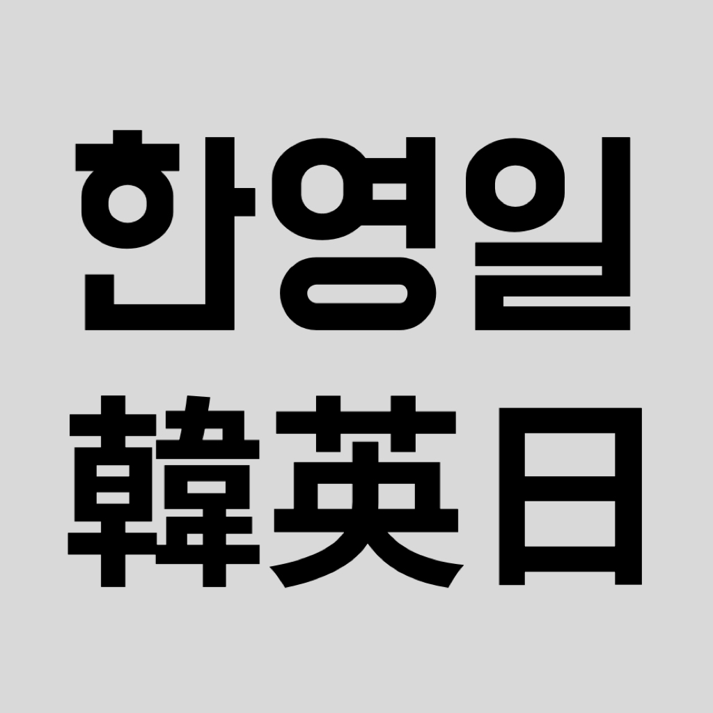

<p align="center">
  
</p>

<h1 align="center">KoEnJa</h1>

<p align="center"><b>한 자판으로 한·영·일 · 一つの配列で韓・英・日 · Korean, English, Japanese on one keyboard</b></p>

<p align="center">KoEnJa（韓英日）は、韓国語・英語・日本語を切り替えなしで入力できるキーボードです。<br>
Mac・Windows の入力メソッド、iOS・Android のキーボードとして開発しています。</p>

<p align="center">
  <a href="https://github.com/studioCIZMO/KoEnJa/releases/latest"></a>
  <a href="https://github.com/studioCIZMO/KoEnJa/actions/workflows/windows.yml"></a>
  
  
  
  <a href="LICENSE"></a>
</p>

<p align="center"><a href="https://cizmo.net/KoEnJa">ウェブサイト</a> · <a href="README.md">한국어</a> · 日本語 · <a href="README.en.md">English</a></p>

<h3 align="center">한/영 キーも、日本語への切り替えも、もう要りません。</h3>

<p align="center">
すべて英字（QWERTY）配列で打ってください。<br>
KoEnJa が<b>単語ごとに</b>英語か、韓国語（2ボル式）か、日本語（ローマ字）かを見分けて、正しい文字で入力します。
</p>

```
dhsmf ghldmldptj GitHub PR flqbfmf Rmxsorh mergegoTdjdy.  →  오늘 회의에서 GitHub PR 리뷰를 끝내고 merge했어요.
Please run the tests again before you push.               →  Please run the tests again before you push.
iPhonedetesutoshimashita⏎                                 →  iPhoneでてすとしました
kinouemailwookutta⏎                                       →  きのうemailをおくった
```

<sub>上の例はエンジンのゴールデンテスト（`Android/engine/src/test/resources/golden.tsv`）からそのまま取ったものです。⏎（Return）はかなのまま確定し、Space で漢字に変換します。</sub>

<p align="center">
  <a href="https://github.com/studioCIZMO/KoEnJa/releases/latest/download/KoEnJa-Mac.zip"></a>
  <a href="https://github.com/studioCIZMO/KoEnJa/releases/latest"></a>
  <a href="https://apps.apple.com/app/id6824875642"></a>
  <a href="https://play.google.com/store/apps/details?id=com.cizmo.koenja"></a>
</p>

<p align="center">
  <a href="https://github.com/studioCIZMO/KoEnJa/releases/latest"></a><br>
  <sub>スマートフォンで読み取るとダウンロードページが開きます</sub>
</p>

## ひと目でわかる KoEnJa

- **単語ごとに自動で**：英語・韓国語・日本語のうち合う言語を単語ごとに選びます。文の途中で言語が変わっても大丈夫です。
- **混ざった単語も**：`githubdp` → `github에`、`googlede` → `googleで`、`beautywo` → `beautyを`
- **間違えたらキーひとつ**：切り替えキー（iOS は `한あA` キー）を押すと、いまの単語が次の言語に変わります。Space で確定した直後でも使えます（`go` → `해`）。
- **優先言語**：あいまいな単語をどちらで読むかを、한국어 우선 と 日本語優先 から選べます。
- **漢字変換**：Windows では Microsoft IME と同じように、Space・変換、F6–F10、Shift+←/→ で文節を扱えます。
- **3 つのプラットフォームで同じ判定**：Swift（iOS）、Kotlin（Android）、C++（Windows）のエンジンが、同じゴールデンテスト 1,950 行を 1 行も違えずに通ります。
- **端末の中だけで**：入力した内容は端末の外に出ません。
- **正解率 99.4%**：Araso の評価ツールで測った値です（学習に使っていない単語・フレーズ 5,998 件、日本語オン、[評価結果](#評価結果)）。

## 目次

- [作った理由](#作った理由)
- [インストール](#インストール)：[Mac](#mac) · [Windows](#windows) · [iOS](#ios) · [Android](#android)
- [キー](#キー)：Mac（[言語切り替えキー](#言語切り替えキー) · [入力ミスの推測](#入力ミスの推測) · [確定したあとの修正と学習](#確定したあとの修正と学習) · [テキスト置換](#テキスト置換) · [一時停止](#一時停止) · [vim](#vim)） · [Windows](#windows-1) · [iOS](#ios-1)
- [設定](#設定) · [設定ファイル](#設定ファイル)
- [判定のしくみ](#判定のしくみ) · [評価結果](#評価結果)
- [既知の制限](#既知の制限)
- [開発](#開発)
- [プライバシー](#プライバシー)
- [KoEnJa と Araso](#koenja-と-araso)
- [問題の報告](#問題の報告) · [コード署名ポリシー](#コード署名ポリシー) · [ライセンス](#ライセンス)

## 作った理由

韓国語・英語・日本語を毎日まぜて書くと入力ソースが 3 つになり、切り替えキーを押す手間も、違う言語で打ってしまう
ことも増えます。macOS では [Araso](https://github.com/nyttastudio/araso) が、単語ごとに言語を見分けるという方法で
これを解決しました。KoEnJa はその判定エンジンを MIT ライセンスに基づいて使い、Araso が動かない iPhone・Android・
Windows でも同じように使えるようにした別製品です。すべての端末で同じエンジンを使えるよう、Araso の macOS 入力メソッドを
もとにした Mac 版も提供しています。

## インストール

### Mac

macOS 13 以降（Apple シリコン、Intel）。[リリース](https://github.com/studioCIZMO/KoEnJa/releases/latest)から `KoEnJa.pkg` を入手して開き、案内に従ってインストールします（0.3.14 から）。またはターミナルで：

```sh
curl -fsSL https://raw.githubusercontent.com/studioCIZMO/KoEnJa/main/Mac/get.sh | sh
```

どちらも `/Library/Input Methods` にインストールします（パッケージはインストール時に、get.sh はそのフォルダを作る一度だけ管理者パスワードを求めます。以前の `~/Library` のコピーは移動します）。`KoEnJa-Mac.zip` を展開して `KoEnJa.app` を `/Library/Input Methods` に直接移しても構いません。続いてシステム設定 → キーボード → 入力ソース → 編集… → ＋ → 韓国語 → **KoEnJa** を
追加します（一覧にない場合は一度ログアウトして再ログイン）。アプリとパッケージは CIZMO の Developer ID で署名し、Apple の公証を受けています。
Araso と一緒にインストールしても、設定と学習した単語は別に保存します（`~/Library/Application Support/KoEnJa`）。
アップデートは入力メニューの「KoEnJa x.y.z にアップデート…」か設定 → 情報から行います。韓国語の単語を1文字打ち間違えたときは、右 ⌥ キーを長押しすると直した候補が出ます。明らかな打ち間違いを単語の終わりで自動的に直すには、設定 → Fix typos（初期設定はオフ）。ソースは `Mac/` にあります。

<details>
<summary>完全に削除する</summary>

設定ウインドウの情報タブ → **アンインストール…** が最も簡単です（「設定と学習した単語も削除」をオンにするとすべて消えます）。ターミナルでは：

```sh
curl -fsSL https://raw.githubusercontent.com/studioCIZMO/KoEnJa/main/Mac/get.sh | sh -s -- --uninstall --delete-data
```

`--delete-data` を外すと設定と学習した単語（`~/Library/Application Support/KoEnJa`）は残ります。どちらも `/Library/Input Methods/KoEnJa.app`（と古い `~/Library/Input Methods/KoEnJa.app`）、パッケージのレシートを消し、入力ソースからも外します。管理者パスワードが必要なら macOS が求めます。
手で消す場合（設定ウインドウを開けないとき）：

```sh
killall KoEnJa 2>/dev/null
sudo rm -rf "/Library/Input Methods/KoEnJa.app" "$HOME/Library/Input Methods/KoEnJa.app"
sudo pkgutil --forget com.cizmo.inputmethod.KoEnJa.pkg
rm -rf "$HOME/Library/Application Support/KoEnJa"      # 設定と学習した単語
defaults delete com.cizmo.inputmethod.KoEnJa 2>/dev/null  # アップデート確認の記録
killall TextInputMenuAgent 2>/dev/null
```

その後、システム設定 → キーボード → 入力ソースから KoEnJa を外してください（一覧に残る場合は一度ログアウトして再ログイン）。
</details>

### Windows

1. [Releases](https://github.com/studioCIZMO/KoEnJa/releases/latest) から `KoEnJa-Setup-0.3.5.exe` をダウンロードして実行します。
2. 0.3.5 はまだコード署名がないため、SmartScreen の「**Windows によって PC が保護されました**」が表示されます。
   「**詳細情報**」→「**実行**」を押し、続く管理者の確認で「**はい**」を押してください。
3. 最後の画面で「**KoEnJa の設定を開く**」にチェックしたまま完了すると、キーボードの種類、使う言語、切り替えキーを
   選べます。あとからはスタートメニューの「**KoEnJa 설정**」で変更できます。
4. **Win+Space** で、またはタスクバー右側の言語表示（あ/한/ENG）をクリックして **KoEnJa** を選びます。

64 ビット版 Windows 10/11（x64）専用で、ARM64 版 Windows にはまだ対応していません。日本語・韓国語の入力方式の
一覧に KoEnJa が追加されます（どちらもなければ韓国語に追加します）。

<details>
<summary>アンインストール</summary>

設定 → アプリ → インストールされているアプリ →「**KoEnJa**」→ アンインストール。入力方式の一覧からも外れます。
使用中のアプリがあれば、一部のファイルは再起動時に削除されます。設定と学習した単語（`%LOCALAPPDATA%\KoEnJa`）は
残すので、不要ならそのフォルダーを削除してください。

</details>

### iOS

[App Store](https://apps.apple.com/app/id6824875642) で入手できます（iOS 16 以降、無料）。
インストール後、アプリで使う言語の順番を選び、設定 → 一般 → キーボードで KoEnJa を追加します。
「**フルアクセスを許可**」は、アプリで選んだ言語の順番と設定をキーボードが読み取り、触覚フィードバックを使うために
必要です（[プライバシー](#プライバシー)）。

### Android

[Google Play](https://play.google.com/store/apps/details?id=com.cizmo.koenja) で入手できます（Android 8.0 以上、無料）。[リリース](https://github.com/studioCIZMO/KoEnJa/releases/latest)の `KoEnJa-Android-0.2.9.apk` からもインストールできます。
インストール後、アプリの「키보드 설정 열기」で 한영일 をオンにし、「입력 방법 고르기」で選んでください（アプリの画面はまだ韓国語のみ）。
Play 版は Google が署名するため、APK 版から Play 版に移るときは APK 版を削除してから Play でインストールしてください。ソースは `Android/` にあります。

## キー

### Mac

打っている途中の単語には下線が引かれ、KoEnJa が予想した言語で表示されます。

| キー | 英語・韓国語の単語 | 日本語のフレーズ |
| --- | --- | --- |
| 文字 | 単語を続けて打つ | フレーズを続けて打つ（かなでプレビュー）。`nn` は常に `ん` なので `rennai` は れんあい、な行の前の ん は n を 3 回（`konnnichiha`、`onnna`）。Microsoft・Google の日本語入力と同じです |
| Caps Lock をオンにして打った文字 | Caps Lock がオフのときと同じように判定（`GKAUS` → `하면`）。英語になるときは大文字のまま（`OUTPUT`）、単語全体がばらばらの字母で 2 つ以上なら同じく大文字（`RST`、`RD`、チャットの字母 `ZZ` も）。辞書にある単語はその言語のまま。単語の途中で切り替えると、そこから新しい単語 | 同じ |
| **[言語切り替えキー](#言語切り替えキー)**（既定は右 ⌥ の単独押しと ⇧Esc） | 読みを切り替え：英語 → 英語＋助詞 → 韓国語 → 日本語 | 同じ（ライブ変換中はまずかなに） |
| 右 ⌥・右 ⇧（言語切り替えキーに選んであるとき）を 0.5 秒押してから離す | [入力ミスの推測](#入力ミスの推測)：キーをひとつ打ち間違えたとしたら何の単語だったか | 何もしない |
| Esc | 確定し、アプリが Esc を受け取る（切り替えキーに選んだときは上のとおり） | ライブ変換中はまずかなに。かなのときはフレーズを取り消す（アプリには届かない） |
| Delete | 英語は 1 文字ずつ。韓国語は打っている音節を字母ひとつずつ、その前は音節ごと（한국 → 한구 → 한ㄱ → 한 → 消える。システムの 2 ボル式と同じ） | かなを 1 文字ずつ（かんこく → かんこ）。ライブ変換中は最後の文節がかなに戻って 1 文字消え、その前の文節は表示のまま（今日はいい天気 → 今日はいいてん）。macOS の日本語入力と同じです |
| **Space** | 確定してスペース | **漢字に変換**（候補ウインドウ） |
| `, . ? !` などの記号 | 確定してその記号 | フレーズに含めて全角に：、。？！ （）＿ 「」（`[ ]`） ・（`/`） 〜（`~`） |
| `-` | 確定して `-` | ー |
| Return | 確定のみ（改行や送信はもう一度押す。設定で変更可） | 表示どおりに確定：かな、またはライブ変換の漢字（改行しない） |
| ⌃K / F7、⌃J / F6 | （アプリのショートカット） | カタカナ / ひらがな（Space で切り替え、Return で確定） |
| Tab、矢印キー、⌘/⌃/⌥ | 確定し、アプリがそのキーを受け取る（⌘ は押した瞬間に確定するので、⌘V は単語のあとに貼り付けられ、⌘⌫ のような削除もこの単語を飛ばさない） | 同じ |
| **右 ⌘**（単独押し。設定で変更可） | このテキストフィールドで KoEnJa を[一時停止](#一時停止) / 再開 | 同じ |

<details>
<summary>変換中（候補ウインドウが開いているとき）</summary>

| キー | 動作 |
| --- | --- |
| Space / ↓、↑ | 次 / 前の候補 |
| ←、→ | 最初の文節を短く / 長くする（`今日は｜いいてんき`） |
| 1–9 | 表示中のページのその候補を確定 |
| Return | 選んでいる候補を確定 |
| Esc | かなに戻る |
| Delete | macOS の日本語入力と同じ：ライブ変換オフでは、表示中の変換から最後の 1 文字を除いて確定（変換 → 変）。オンでは、フレーズの入力に戻り、最後の文節がかなに戻って 1 文字消える（今日はいい天気 → 今日はいいてん） |
| 文字、句読点 | 確定してそのまま打ち続ける |

変換は文節ごとに進みます。候補を出している文節には太い下線、残りの読みには細い下線が引かれるので、←/→ で区切りが
どこに来たかがわかります（下線のスタイルを無視するアプリでは 1 本線になります）。読みの先頭だけを覆う候補
（きょうはいいてんきですね に対する `今日は`）はその部分を確定し、残りの変換を続けます。候補ウインドウには
エンジンが持つ同音語がすべて並び、珍しい漢字ほど後ろに来ます（しょう に対する `硝`）。ウインドウは文節の下に、
切り替えキーの帯と同じ紙の上に開き、各候補は文節と同じ位置から始まり、いまの候補は同じ青いカプセルに入ります。
1 ページに 9 つ、番号つきで、その下に読みとページ（`きょうは · 1/2`）が出て、10 番目の候補で次のページに移ります。
幅はどのページでもいちばん長い候補に合わせるので、ページをめくっても何も動かず、画面の下端近くでは文節の上に
開きます。クリックでも選べます。

</details>

<details>
<summary>日本語のあとの記号と数字</summary>

日本語のあとに単独で打った記号は、日本語 IME と同じように全角になり、下線が付いたままになります
（`！`、`＿`、`「`）。

- Return で確定し（改行しない）、Space でほかの形（`!`、`‼︎`、`『`…）が出て、文字を打つと確定して新しい単語が
  始まります。
- 数字の中（`3.5`、`10:30`）では半角のままで、全角で開いた括弧は英単語のあとでも全角で閉じます
  （`日本語（English）`）。

日本語がオンのときは、数字と記号も日本語にできます。

- 文の始めや韓国語・英語のあとに単独で打つと半角で入りますが、直後に言語切り替えキーを押すと日本語の形になって
  下線が付きます（`123` → `１２３`、`[` → `「`、`?` → `？`）。
- 日本語の文の中で数字のすぐあとに打った単語は助数詞として読み、Space で数字ごと変換します（`3ji` → `3時`、
  `5fun` → `5分`）。`5km` や `3pm` のようにローマ字でない単位は英語のままです。

</details>

#### 言語切り替えキー

読みを切り替えるキーは、設定ウインドウの **キー** パネルでキーキャップをクリックして選びます：右 ⌥ の単独押し、
⌥Space、右 ⇧ の単独押し、Esc、⇧Esc から、いくつでも選べます。既定は **右 ⌥ の単独押し** と **⇧Esc** です。
選んでいないキーはアプリに届きます。

押すと、単語の読みが下に縦の帯で並びます（`dkssud`、次に `안녕`、1 行にひとつずつ）。↓ と ↑ で次と前に移ります。
画面に出ている読みは、入力ソースを切り替えたときに macOS がキャレットの下に出すものと同じ青いカプセルに入り、
ほかの読みは入力されるときの形でその隣に並ぶので、あと何回押すと何になるかがわかります。ほかのキーを押すと
帯はすぐに消えます。読みには番号が付いていて、候補ウインドウと同じく数字かクリックで選べます。打っている単語は
その読みで確定し（Return と同じく、あとにスペースは入らず、切り替えキーでまだ変えられます）、確定したばかりの単語は
その読みに切り替わります。3 ボル式では数字キーが字母なので、打っている単語には番号が付きません。長い読みは
140 pt で切り、画面の下端近くでは帯を単語の上に出します。動きは 0.2 秒以内に終わり、システム設定で「視差効果を減らす」
をオンにしていると動きません。

- **右 ⌥ または右 ⇧ の単独押し**：アプリは修飾キーだけの押下には反応しないので、ウインドウを閉じたり入力を
  消したりすることがありません。ほかの修飾キーと一緒に押したときは使わないので、Hyper キー（Raycast や Karabiner で
  ⌃⌥⇧⌘ を同時に送るもの）に割り当てたキーは、割り当てたとおりに動き続けます。その場合は別のキーを選んでください。
- **⌥Space**：本来はノーブレークスペースを入力するキーですが、選ぶと入力しなくなります。
- **Esc**：慣れていれば手早く使えます。ただし Claude のデスクトップアプリや Slack のような Chromium ベースのアプリは、
  入力メソッドが受け取った Esc も見るので、単語が変わると同時にウインドウを閉じたり入力を取り消したりすることが
  あります。変えるものがないときは、Esc はアプリに届きます。
- **⇧Esc**：変えるものがないときは何もせず、アプリにも届きません。

アプリごとの設定で、そのアプリだけ別のキーを選べます。たとえば普段は Esc で切り替え、エディタのように Esc が
アプリに届かないと困るところでは Esc を外す、といった使い方です。入力メニューの「Esc で言語を切り替える」は、
前面のアプリについて Esc だけを足したり外したりします。日本語の候補ウインドウの中と、ライブ変換で漢字が表示されて
いる間は、どのキーを選んでいても Esc はまずかなに戻ります。ライブ変換がかなのまま残したフレーズ（`たけ`）では、
切り替えキーはすぐに切り替えます。

#### 入力ミスの推測

速く打つと、キーをひとつ打ち間違えることがあります：隣り合う 2 つのキーが入れ替わる、キーが抜ける、2 回押される、
Shift が遅れる、隣のキーを押す、などです。これをハングルとして組み立てると、ばらばらの字母（`clekkr` → `치다ㅏㄱ`）や
別の音節（`djddj` → `엉어`）が残ります。

- **右 ⌥（または右 ⇧。言語切り替えキーに選んであるとき）を 0.5 秒押してから離す**（Esc・⇧Esc・⌥Space は長押ししても推測は開きません）：確定したばかりの（または打っている）単語から 1 キー違いの単語が、
  漢字の候補のように並び、最初のものがその場所に入ります（`엉어` → `영어`）。押している間は単語の下に赤い波線が
  描かれていき、離すタイミングがわかります。それぞれの推測で変わった部分は色付きの波線で示します。もう一度長押し
  するか ↓・↑ で別の候補に、数字、クリック、Return で選びます。Esc と Delete で元の単語に戻ります。ほかのキーを
  押すと、表示中のものを残して続けます。推測できるものがないときは「推測なし」が少しの間表示されます。2 ボル式のみ、
  打ち間違いはひとつだけです。
  macOS のターミナルでは、一覧が開いている間は推測に下線が付いたままで、選んだときに入力されます。`cat` の中のように
  シェルのプロンプト以外では、Space のあとの単語を置き換えると画面上は崩れて見えることがありますが、行そのものは
  正しくなっています。
  Ghostty のように KoEnJa がテキストを読めないアプリでは、打っている途中の単語だけが推測の対象です。Space のあとの
  単語（`holdSpace` で下線を残した単語も）は置き換えられないので、「推測なし」が出ます。
- **入力ミスを直す**（設定 → キー、`fixSlips`、初期設定はオフ）：はっきりしているときは、単語が終わるとき（Space、
  句読点）に直し、「✦ 入力ミスを修正」が少しの間表示されます（`clekkr` → `치다가`）。直すのは、打ったとおりのキーでは
  ばらばらの字母や誰も打たない音節が残り（音節だけの単語では、終声の Shift の場合のみ：`햇어요` → `했어요`）、英語には
  見えず、チャットの字母で終わらず（`고마워ㅠ`）、最初の推測がほかのどれよりもずっとよく使われるときだけです。
  URL やパスの中、Strict のアプリ、辞書が知っているキー、切り替えキーで切り替えた単語では直しません。
- 直した直後の **Delete** で、単語は打ったとおりに戻り、スペースは残ります。そのままにすると（次の単語を打つ、または
  別の読みに切り替える）、そのキーは辞書に入り、もう直されません。さらに消した場合は何も学習しません。直したまま
  にしたときは何も学習しません。
- 辞書が覚えているキーで推測を選ぶと、そのキーは忘れられ（「元に戻す」）、また直されるようになります。

#### 確定したあとの修正と学習

Space や句読点で単語を確定した直後（または Return で確定だけしたとき）、言語切り替えキーを押すと次の読みに
切り替わり、さらに押すと順に切り替わり続けます。句読点のあとにさらに記号、数字、スペースを打っても（`world. `、
`world?! `、`안녕.12`）、先にスペースや句読点を消しても、このチャンスは残ります。それ以外のキーを押すと終わります。
キャレットが単語のすぐあとにあり、そこでアプリが KoEnJa にテキストを読ませる必要があります。このように切り替えた
直後は帯に番号が付き、数字を押すとその読みを選んで閉じます（帯をクリックしたときと同じ）。Return は表示中の読みを
残して閉じ、改行はしません。そのあと ←/→ はキャレットを動かします（切り替えずに打った数字はいつもどおり入ります）。

行の前のほうにある単語も直せます。単語の中のどこかにキャレットを置き（クリック、⌥←、⌥→）、右 ⌥（または ⇧Esc、
選んでいれば ⌥Space）を押すと、その単語だけにまた下線が付いて次の読みになり、キャレットは単語の終わりに来ます。
あとの単語はそのままです。フィールドの最初の単語も直せます：macOS のテキストビューはキャレットの位置に未確定文字を
置くので、キャレットを単語の先頭に動かし、フィールドの先頭では修正が終わるまで、前の文字の代わりにゼロ幅スペースを
置きます。もう一度押すと切り替わり続け、日本語の変換と同じく太い下線が直している部分です。→ で 1 キー長くなり、
単語の終わりを越えると次の単語も取り込みます（`dkssud gktpdy` → `안녕 하세요`、下線も一緒に伸びます）。← で短くなり、
単語の途中で切ると残りのキーは単独で読みます（`hellofmf` → `hello` + `를`）。← で外れた単語は元の読みのままですが、
細い下線は残ります。
下の帯もこれに合わせて、直している部分の読みを番号付きで並べます：候補ウインドウと同じく、数字かクリックでその読みを
選び、Return と同じように進みます。切った前の部分が決まって残りを次に直し、そうでなければ修正は終わりです。そうした
前の部分で Return を押すと、それを決めて残りに進みます。⇧←/⇧→ は部分の始まりを動かし（韓国語は音節ごと、日本語は
かなごと）、その前に残る部分は入力したときのままです。そのため、混ざった単語の韓国語の部分や漢字の中には入りません。
その後の ←/→ は、そのあとに残る部分も入力したときのままになる位置でだけ止まります。← では単語の真ん中だけが変わります
（`hellodkssudworld` で ⇧→ を 5 回、← を 5 回 → `hello` | `안녕` | `world`）。始まりは最初の単語の中でだけ動きます：
その前の単語も直すには、その単語から始めて → で広げてください。打っている単語も同じように切れます：切り替えキーで
読みを変えたあとは ←/→ ですぐに、その前なら ⇧← で始まり、キーひとつ分切れます（`helloab` で ⇧←← → `hello` | `ab`。
切り替える前の ← は、これまでどおり単語を入力してキャレットを動かします）。単語全体を日本語として直したときは、
Space で候補ウインドウが開き、打っている単語と同じように選びます（Space と ↑/↓ で候補、←/→ で文節の長さを変え、
Return か数字で選んで修正を終え、Esc でかなに戻ります）。Space や Return で確定したばかりの単語も、切り替えキーで
変えたあとに ← か → を押すと、このような修正になります（→ は単語が行の終わりにあるときだけ。切り替える前なら、
⌥← で単語の先頭に行ってから切り替えキー）。Return やほかのキーを押すと修正を入力し、キャレットを行の終わりに戻します
（⌘Z は 2 回かかります：1 回目で行の残りを選択し、2 回目で修正を元に戻します）。修正したのが行の最後の単語全体で
（切っていない）、直後に切り替えキーを押すと、確定したばかりの単語と同じくもう一度変わります。Esc（切り替えキーで
ない場合）と Delete は、何かに手を付ける前の状態に戻します：打っている単語は切り替える前の読みでまた打っている状態に、
確定したばかりの単語は入力したときの形に戻り、切り替えキーでまた変えられます。下線は単語だけに付き、あとのスペースや
記号には付きません（ただし切り替えで変わる 3 ボル式の記号と、確定直後のカンマとスペースのように、キャレットの位置の
都合で単語と一緒に動くものは除きます）。単語全体を直したときは、確定直後と同じように修正として学習します。切った単語は
学習しません。Return より前の単語と、そのあと手で変えた単語は直せません。

一度直した単語は、それ以降その方向に傾きます：きわどい場合（`so`/`내`）は変わり、はっきりしている場合は変わらないので、
うっかり切り替えてもあまり影響しません。30 日のあいだにもう一度直すか、同じ形で打たなければ忘れます。同じキーを同じ
ように 2 回直すと、KoEnJa はいつもそう書くようになり、あとに助詞が付いても同じです（`ghostty` を覚えさせると
`ghostty에` になります）。単語を KoEnJa の推測に戻すと忘れ、覚えた単語をさらに別の読みに切り替えると、2 回目でその読みに
記憶が移ります。切り替えキーの帯では、読みのあとのチェック（✓）が辞書の覚えているもの（2 回直したもの、または自分で
追加した単語）、鉛筆（✎）が 1 回直したものを示します。修正のあとに押したキーで、帯そのものが選んだ読みのカプセルに
縮んで単語の最初の文字の下に収まり、何が起きたかを少しの間示します：最初に直したあとは鉛筆と **メモ**、学習したときは
描かれていくチェックと **学習済み**、KoEnJa の選択に戻して忘れたときはグレーの上に戻る矢印（↺）と **元に戻す** です。
何も変わらなかったときは、帯はそのまま閉じます。
単語が辞書のせいでそう入ったのかを知るには、入力メニューの **辞書が変えた単語** を開きます：辞書が決めた最近の単語 5 つが
`ghostty → English` のように並び、選ぶとその単語を忘れます（一覧は入力メソッドが再起動するまでしか残らず、保存は
しません）。間違って覚えた単語があれば、入力メニューの **最後の学習を取り消す** を選んでください。長いトークン（文を
まとめて切り替えたときのように 20 キーを超えるもの）は覚えません。

<details>
<summary>それができないアプリでは：Space・句読点のあとも単語を保持</summary>

ターミナルのように KoEnJa がテキストを読めないアプリでは、そのアプリで **Space・句読点のあとも単語を保持** をオンに
します（入力メニュー、または設定ウインドウのアプリごと。`apps.json` の `holdSpace`）。すると Space や句読点（`. , ? !`
などの記号すべて。数字は除く）で単語が終わらず、それも下線の中に入ります。

- 下線が付いている間は打っている単語と同じです：言語切り替えキーで変わり（`dkssud.` → `안녕.`、記号は打ったまま）、
  Delete で消えます（スペースや記号から）。
- 次の単語を打ち始めると、その文字と一緒に入力されます。⌘ を押したときも同じです（どのアプリでも、下線の付いた単語では
  そうなります）。そのため ⌘V は単語のあとに貼り付けられ、⌘⌫ がこの単語を飛ばしてその前のテキストを消すこともありません
  （ターミナルは ⌘V と ⌘⌫ を自分で処理し、KoEnJa にキーを見せません）。そのあとは切り替えキーで単語を変えられません。
- 保持するのは 1 文字だけです：`안녕.` のあとの Space や 2 つ目の記号は単語を終わらせ、保持がオフのときと同じに扱います
  （ふつうはアプリへ。日本語として入った単語のあとでは、日本語のあとの記号の規則に従います）。
- Return は、下線の付いたほかの単語と同じく確定だけなので（`returnConfirmsOnly`、初期設定はオン）、改行やコマンドの実行にはもう一度押してください。この設定をオフにすると、最初の Return でコマンドが実行されます。
- アプリは Space キーを受け取らないので、アプリのテキスト置換は働きません。

</details>

#### テキスト置換

システム設定 → キーボード → ユーザ辞書（テキスト置換）の入力文字列のうち、韓国語や日本語として読めるもの
（`주소`、`ㅈㅅ`、`よろ`）は、推測にかかわらずその言語で表示されるので、システムの入力と同じようにアプリが Space で
置き換えます。英語の入力文字列はいつもどおり判定します。

- 日本語の入力文字列の変換語は Space で最初の候補になり、複数登録した入力文字列はすべての変換語を順に出します。
  日本語の入力文字列はひらがなの読み（`よろ`、`ぐー`）で登録してください。
- 複数登録した（変換語が 2 つ以上ある）韓国語や英語の入力文字列は、Space で同じ候補ウインドウに変換語を並べ、最後に
  打ったままの入力文字列を出します：選んだものがスペースと一緒に入り、Esc で入力文字列に戻ります。変換語がひとつなら、
  これまでどおりアプリが置き換えます（macOS はアプリに入力文字列ひとつにつき変換語をひとつしか渡しません）。
- 置き換えるのはアプリなので、テキスト置換のないアプリ（ターミナル、Chrome…）には、候補ウインドウで選んだ変換語だけが
  入ります。
- 一覧の変更は、次にテキストフィールドがアクティブになったときから反映されます。

#### 一時停止

ターミナルの lazygit や htop のように、すべてのキーがコマンドになるところでは、**右 ⌘** を単独で押します。打っている
途中の単語が入力され、そのテキストフィールドではキーが打ったとおりに通るようになります。もう一度押すか、別のアプリや
テキストフィールドに移るか、設定を変えると再開します。

押すたびに、入力ソースの表示のように 한 がキャレットの下に少しの間表示され、一時停止中はグレーの上に取り消し線が
付きます。メニューバーのアイコンは変わらないので、あとで確かめるには入力メニューのチェックを見てください。

一時停止キーは設定ウインドウの **キー** で変えられます：右 ⌘、⌥、⇧、⌃ の単独押し、記録したショートカット（⌃⌥P のように
⌘、⌃、⌥ を含むもの、またはファンクションキー単独）、またはなし。言語を切り替えるキー（右 ⌥ か ⇧、⌥Space）や、かなを
入力するキー（⌃J、⌃K、F6、F7）は選べません。アプリのメニューにもあるショートカットは、アプリが先に受け取ることが
あります。

#### vim

neovim では [`Mac/vim/koenja.lua`](Mac/vim/koenja.lua) を `~/.config/nvim/plugin/` に、
Vim（8.2 以降、`+job`）では [`Mac/vim/koenja.vim`](Mac/vim/koenja.vim) を `~/.vim/plugin/` に置きます。

すると Vim がモードが変わるたびに KoEnJa に知らせるので、単語を判定するのは挿入モードだけになり、ノーマル、ビジュアル、
コマンドラインモードではキーがそのまま vim に届きます：`s`、`dd`、`ciw`、`:wq⏎` がキーごとに動きます。vim の中では
Esc は常に vim に届くので、アプリごとの設定はいりません。vim を終了すると、シェルでまた単語を判定します。

<details>
<summary>しくみと注意点</summary>

- 知らせは `KoEnJa --vim insert|normal|off --app <bundle id>` で、キーごとではなくモードが変わるとき（挿入モードに
  入る・出る、起動、終了、フォーカス）に送ります。
- バンドル ID は macOS がすべてのアプリに設定する `$__CFBundleIdentifier` を使うので、ターミナルごとの設定は不要で
  （Ghostty、ターミナル、iTerm2、VS Code…）、知らせはそのアプリのテキストフィールドにだけ届きます。`--app` のない
  知らせは、Esc が切り替えキーでないところでだけ受け取ります。
- tmux のサーバーを起動したのとは別のターミナルから tmux にアタッチすると、バンドル ID が違うので知らせは無視されます。
- Vim がターミナルのフォーカスの変化を受け取れない場合、KoEnJa は vim のペインからシェルのペインに移ったことがわかり
  ません。そこで ⇧Esc を押すと（切り替えキーにしている場合）、また単語を判定し始めます。

</details>

### Windows

| キー | 動作 |
| --- | --- |
| 切り替えキー（入力中） | いま打っている単語を次の言語に変えます。 |
| 切り替えキー（入力していないとき） | 3 言語とも使うときは優先言語を切り替えます（**한국어 우선 ↔ 日本語優先**）。한국어 + English か 日本語 + English だけなら KoEnJa のオン・オフです（オフは英語そのまま）。 |
| Space・変換 | 日本語を漢字に変換します。もう一度押すと候補一覧が開きます。 |
| Space・Tab・↓ / Shift+Space・↑ | 候補一覧で次 / 前の候補。PageDown・PageUp はページ単位。 |
| 1–9 | 一覧の候補を選びます。 |
| Return | すべて確定します。変換前ならかなのまま確定します。 |
| Esc・Backspace | 変換をやめてかなに戻ります。 |
| Shift+← / Shift+→ | 最初の文節を短く / 長くします。→ は最初の文節を確定して残りを変換します。 |
| F6・F7・無変換 | ひらがな・カタカナ・その切り替え |
| F8・F9・F10 | 半角カタカナ・全角英字・半角英字 |
| 半角/全角（日本語キーボード） | KoEnJa のオン・オフ |

**切り替えキーの既定**は、韓国語 / 英語（US）キーボードでは右 Alt の単独押し（= 한/영）、日本語（JIS）キーボードでは
無変換です。KoEnJa の設定で、左 Ctrl の単独押し、한/영、変換、無変換、Ctrl+Shift、Shift+Space、Ctrl+Space から
選べます。Ctrl+Shift を使うには、Windows の Ctrl+Shift によるキーボード レイアウト切り替えをオフにしてください
（設定 > 時刻と言語 > 入力 > キーボードの詳細設定 > 入力言語のホットキー）。

### iOS

- **`한あA` キー**：いまの単語を次の言語に変えます。Space で確定した直後に押すと、いま入れた単語を変えます。
- 使う言語とその順番はアプリで選びます。先にある言語が、あいまいな単語を取ります。
- 日本語を打っている間は候補バーに変換候補が出て、確定したあとは続きそうな言葉を表示します。
- **候補と修正**（アプリの設定）：候補の単語、自動修正、キーの端のタッチ補正、次の単語の予測を個別にオフにできます。オフにした機能は計算しないので、入力が軽くなります。

## 設定

ここでは Mac の入力メソッドの設定を説明します（iOS、Android、Windows にはそれぞれ設定画面があります）。入力メニュー
（한영일 を選んでいるときのメニューバー）からは、次のことができます。

- このテキストフィールドで KoEnJa を一時停止する（一時停止キーと同じ）
- 前面のアプリについて、単語の変換のオン・オフ、変換のしきい値（Normal/Strict）、Esc で言語を切り替えるか、
  Space・句読点のあとも単語を保持するか、日本語をオンにするかを設定し、またはそのアプリの設定を消す。変換がオフの間は
  これらはグレーになります
- 日本語入力（既定。個別の設定がないすべてのアプリに適用）とライブ変換のオン・オフ
- 最後の学習を取り消す、辞書が最近変えた単語を見て忘れさせる、入力してみる・辞書・設定ウインドウを開く

設定ウインドウには次のパネルがあり、変更はすぐに反映されます。

| パネル | 内容 |
| --- | --- |
| 言語 | 単語の変換のオン・オフ、日本語のオン・オフ、配列カード（ハングル：2ボル式（두벌식）・3ボル式 最終・3ボル式 390。英語とローマ字：QWERTY、Colemak、Colemak-DH）、日本語入力とそのオプション、漢字候補の順番のリセット |
| キー | 言語切り替えキー、Return、一時停止キー |
| アプリごと | 単語を変換するのに必要な確かさ（Normal、Strict）と、アプリごとの動作：日本語、切り替えキー、Space・句読点のあと（`apps.json`） |
| 辞書 | 追加した単語と学習した単語をひとつの一覧で（`dictionary.json`）：**+** でキーを打ち、その読み（英語、韓国語、日本語）とアプリを選びます。行の ⋯ から、学習した単語をずっと残したり削除したりできます。1 回直した単語には、忘れるまでの残り期間が表示されます |
| 入力してみる | 各単語がどう判定されたかを点数付きで表示し、そのキーを辞書に追加できます |
| 情報 | バージョン、変更点、アップデート、アンインストール |

### 設定ファイル

メニューも設定ウインドウも、`~/Library/Application Support/KoEnJa/` の JSON ファイルに書き込みます。
手で編集しても構いません。ないキーや、型の違う値（引用符で囲んだ `"true"`）は既定値のままになります。JSON として
読めないファイルは上書きせず、`settings.json.unreadable` のような名前で脇に移します（`apps.json` と `dictionary.json`
も同じです）。これらのファイルを手で編集したあとは、入力メソッドを再起動してください：`pkill -x KoEnJa`。

<details>
<summary><code>settings.json</code>：全体の設定</summary>

```json
{ "japanese": true, "liveConversion": true }
```

| キー | 既定 | 内容 |
| --- | --- | --- |
| `japanese` | **オフ** | ローマ字の日本語を見分けて変換します。 |
| `liveConversion` | オフ | 日本語のフレーズを打っている間、漢字の第一候補を表示します（`今日はいい天気でs`）。Return で表示どおりに確定します。macOS のライブ変換と同じです。 |
| `returnConfirmsOnly` | オン | 下線の付いた単語での Return は確定だけします。オフにすると、その Return もアプリに届きます（日本語のフレーズは確定だけのままです）。 |
| `fixSlips` | オフ | 打ったままでは韓国語になりえない、韓国語の単語から 1 キー違いの単語を、単語の終わりでその単語として入力します（[入力ミスの推測](#入力ミスの推測)）。直後の Delete で元に戻ります。 |
| `pauseKey` | `"rightCommand"` | 一時停止キー（[一時停止](#一時停止)を参照）：単独押しの `"rightCommand"`、`"rightOption"`、`"rightShift"`、`"rightControl"`、`"off"`、または `{ "keyCode": 35, "modifiers": ["control", "option"], "key": "P" }` のようなショートカット。以前の `"rightCommandPause": false` は `"off"` として読みます。 |
| `fullWidthDigits` | オフ | 日本語のあとの数字を全角で出し（`１２３`、住所や電話番号の `０３－１２３４`）、下線を付けて、Space で `123`（半角）や `三月` のような変換を出します。 |
| `fullWidthSpace` | オフ | 日本語のあとの Space で全角スペース（`　`）を入力します。⇧Space はもう一方の幅を入力します（これがオフのときは全角）。 |
| `latinLayout` | `"qwerty"` | 英語とローマ字を打つ配列。ほかに `"colemak"`、`"colemakDH"`。韓国語は配列にかかわらずいつものキー（QWERTY のもの）のままです。ある配列で学習した単語は、キーが違うので別の配列ではあらためて学習します。 |
| `japaneseLayout` | なし | ローマ字を打つ配列（`"qwerty"`、`"colemak"`、`"colemakDH"`）。なければ `latinLayout` のものを使います。たとえば英語は Colemak、ローマ字は QWERTY にできます。 |
| `koreanLayout` | `"dubeolsik"` | 韓国語の配列。`"sebeolsikFinal"` は 3ボル式 最終（세벌식 최종）、`"sebeolsik390"` は 3ボル式 390（세벌식 390）。数字や記号のキーにある字母（갔 の ㅆ は 2、밥 の ㅂ は ;）は、単語の中で合う場所では字母として、合わない場所では記号として読みます（안녕! の !）。数字だけなら数字のままですが、韓国語のあとの 00 は ㅋㅋ になります（ほかの ㅋㅋ や ㅠㅠ（55）は切り替えキーで）。3 ボル式で数字や記号を打つキー（최종 では ⇧B ?、⇧/ !、⇧H 0、[ (、390 では ⇧B !、⇧M 1）は、韓国語の単語の直後とそれに続く記号では 3 ボル式のものを、それ以外では QWERTY のものを打ちます（Bob）。直後に切り替えキーを押すと、打ったとおりのキーに戻ります（지냈어? → ldhr2jtB）。 |
| `japaneseEngine` | `"apple"` | 漢字変換：`"apple"` は macOS の日本語入力のエンジンを、`"azooKey"` はアプリ内の AzooKey 変換器を使います。 |
| `checkForUpdates` | オン | 1 日に 1 回、GitHub に最新リリースのバージョンを問い合わせ（ほかには何も送りません）、新しければ入力メニューと情報にそう表示します。 |
| `displayLanguage` | なし | 設定ウインドウと入力メニューの言語（`"en"`、`"ko"`）。なければシステムの言語です。 |

ライブ変換がオンのとき：

- Space で、次の候補を選んだ状態で候補ウインドウが開きます。かながまだ表示されているとき（`しょう`）は、最初の変換
  （`翔`）で開きます。
- Esc でかなを表示します。もう一度 Esc を押すと、Esc が切り替えキーなら言語を切り替え、そうでなければ macOS の日本語入力と
  同じくフレーズを取り消します（アプリには届きません）。
- 短い読みは漢字のときだけ変わります（`と` は `と` のまま、`私` は変換）。
- 第一候補が正しいのは短いフレーズでおよそ 5 つに 4 つ、文全体で 4 つに 3 つです
  （[学習に使っていないデータでの結果](#評価結果)）。Return の前に一度見てください。変換には 1 キーあたり 8–21 ms
  かかります。

</details>

<details>
<summary><code>apps.json</code>：アプリごとの動作</summary>

`"*"` はすべてのアプリに対する自分の既定で、アプリ（バンドル ID）にはそれと違うキーだけを書きます。`.` で終わるキーは
前方一致で、複数当てはまるときはいちばん長いものを使います。自分で書かない限り、どのアプリも載っていません。

```json
{ "*":                     { "switchKeys": ["escape", "shiftEscape"] },
  "com.microsoft.VSCode":  { "switchKeys": ["rightOption", "shiftEscape"] },
  "com.apple.Terminal":    { "conversionThreshold": 0.97 },
  "com.example.Game":      { "enabled": false } }
```

| キー | 既定 | 内容 |
| --- | --- | --- |
| `enabled` | `true` | `false` にするとすべてのキーをそのまま通します（ただの英語）。 |
| `conversionThreshold` | `0.5` | 少なくともこれだけ確かなときだけ、打った文字から変換します。`0.97`（Strict）にすると、ターミナルで短いシェルコマンドがハングルになりません。`0.5` は文章を書くときに韓国語をより多く変換します。 |
| `switchKeys` | `["rightOption", "shiftEscape"]` | 読みを切り替えるキー（[言語切り替えキー](#言語切り替えキー)）：`"rightOption"`（右 ⌥ の単独押し）、`"optionSpace"`（⌥Space）、`"rightShift"`（右 ⇧ の単独押し）、`"escape"`（Esc）、`"shiftEscape"`（⇧Esc）。選んでいないキーはアプリに届きます。0.1.8 以前の `escapeToApp` も読んで引き継ぎます。 |
| `holdSpace` | `false` | Space や句読点（数字は除く）で単語を終わらせず、下線の中に入れます。打っている単語と同じく、切り替えキーで変わり、Delete で消えます。次の単語を打つと、その文字と一緒に入力されます。確定した単語を変えられないターミナル向けなので、アプリごとに設定します（`"*"` に書くとすべてのアプリで保持します）。Return は `returnConfirmsOnly` に従い（既定では確定だけ）、テキスト置換は働きません。 |
| `fullWidth` | `true` | `false` にすると、全角の設定にかかわらず、このアプリでは数字とスペースを半角のままにします（ターミナル、コードエディタ）。 |
| `japanese` | なし | このアプリでの日本語。書かなければ `settings.json` の `japanese` に従います。`false` にすると、日本語がオンでもここでは韓国語と英語の間だけで判定し（変換もライブ変換もなし）、`true` にするとオフでもここでは日本語を打てます。アプリごとにだけ設定します。 |

</details>

## 判定のしくみ

KoEnJa の判定は [Araso](https://github.com/nyttastudio/araso) のエンジンによるものです。詳しくは
[Araso の判定方法（韓国語）](https://github.com/nyttastudio/araso#판단-방식)をご覧ください。要点は次のとおりです。

- 同じキーを英語、韓国語（2ボル式）、日本語（ローマ字 → かな）として読み、それぞれ点数をつけます。
  英語は文字 3-gram と SCOWL の単語リスト、韓国語は音節の頻度と単語リスト、日本語はかなの 3-gram を使います。
- 大文字、数字、URL・パスといった規則と、直前の単語の言語もあわせて見ます。前の単語と違う言語に切り替えて打つ場合も考慮します。
- 英単語 + 韓国語の助詞（`githubdp` → `github에`）、英単語 + 日本語（`googlede` → `googleで`）のような混ざった単語は分けて読みます。
- 優先言語は、あいまいな単語でその言語に少し多く点数を与えます。

KoEnJa での変更は `Packages/SeamtypeCore/UPSTREAM` に記載し、コードに `// REA:` で印をつけています。韓国語の単語
リストをハッシュで持ってメモリを減らしたこと、画面に表示したとおりに確定すること、大文字で始まる英単語に続く日本語、
アドレスの後の助詞、URL 内のドットファイルなどの規則です。

## 評価結果

Araso の評価ツール（`tools/prepare.sh`、`eval_convert.py`、`eval_context.py`）をそのまま使い、同じ Mac・同じデータで
Araso 本家（22e7d3d）と KoEnJa のエンジンを並べて測りました（2026-10-23、Apple M4、macOS 26.7.2）。すべての表、
コマンド、データのハッシュは [docs/evaluation.md](docs/evaluation.md)（英語）にあります。エンジンを Araso 0.3.1（eee3cbd）に
更新したあと（2026-10-26）同じ方法で測り直し、下の言語判定と漢字変換の数値は Araso 0.3.1・KoEnJa ともに変わりませんでした。

**学習に使っていないデータ**（英単語 2,011 件、韓国語の単語 1,987 件、日本語のフレーズ 2,000 件）

| | Araso README（公表値） | Araso 22e7d3d（この Mac） | KoEnJa エンジン（この Mac） |
| --- | --- | --- | --- |
| 日本語オフ（英/韓） | 99.82% | 99.77% | 99.77% |
| 日本語オン（英/韓/日） | 99.50% | 99.40% | 99.40% |

2 つのエンジンは 5,998 件すべてで同じ答えを出しました。日本語オンで英語 99.25%、韓国語 99.80%、日本語 99.15% です。

**漢字変換**（第 1 候補が原文と完全に一致する割合、学習に使っていない Tatoeba の文 400 件ずつ）

| | AzooKey + 並べ替え（iOS が使う経路） | 候補一覧の中に正解 |
| --- | --- | --- |
| 2–3 語のフレーズ | 79.8% | 94.8% |
| 文全体 | 68.5% | 84.2% |

Araso 本家と KoEnJa のエンジンで同じ値です。Android と Windows は Mozc 辞書を使う独自の変換器のため、このツールでは
測れていません。

**文中のよく使う単語**（`eval_context.py`：よく使う英語・韓国語の単語 10,000 語を各言語の後に置いたとき、上位 1,000 語 / 10,000 語のうち誤りの数）

| | 前に何もないとき | 同じ言語の後 | 別の言語の後 | 日本語の後 |
| --- | --- | --- | --- | --- |
| 韓国語の単語 | 9 / 33 | 2 / 15 | 13 / 62 | 9 / 34 |
| 英単語 | 2 / 48 | 0 / 23 | 8 / 71 | 2 / 86 |

どちらのエンジンも同じ値です。Araso の公表値と少し違うのは、Tatoeba のデータをその日に取り直したことと、公表値が
その後のエンジン変更より前に測られたためと考えられます（本家でも同じ差が出ます）。

**KoEnJa のエンジンで違う点**

- メモリ：同じ判定処理で最大メモリが 58.0 MB → 39.2 MB（約 19 MB 減、`araso-cli`、macOS）。
- 上の評価は単語を 1 つずつ判定する経路なので、KoEnJa の入力セッションの変更は通りません。同じ 5,998 件を入力
  セッションで打つと（`araso-cli --type`、参考値）13 件が変わり、KoEnJa が 6 件多く正解し、4 件多く誤りました。
  [詳細](docs/evaluation.md#supplementary-through-inputsession-not-one-of-arasos-published-evaluations)

**3 つのエンジンが同じか**（ゴールデンテスト：975 通りのキー入力 × 言語の順番 2 通り）

| エンジン | 結果 |
| --- | --- |
| Swift（iOS） | `golden.tsv` を作り直すと 1,950 行すべて一致 |
| Kotlin（Android） | 1950/1950 |
| C++ clang（macOS） | 1950/1950、1 キーあたり 8.3 µs（Apple M4、1,932 行の時点で計測） |
| C++ MSVC（CI、GitHub windows-2022） | 1950/1950、1 キーあたり 25.7–26.1 µs（1,932 行の時点の 3 回） |

MSVC のゴールデンテストは `main` への push のたびに [CI](.github/workflows/windows.yml) で実行されます。

## 既知の制限

- Windows 0.3.5 はコード署名がありません（[コード署名ポリシー](#コード署名ポリシー)）。x64 専用で、ARM64 版 Windows には対応していません。
- 2 つの言語のどちらでも意味が通るキー（`go`/해、`so`/내）は間違えることがあります。切り替えキーで直してください。
- 英単語に日本語の助詞をつけると、日本語として読まれることがあります（`sitede` → `してで`、`tokenwo` → `とけんを`）。
- 漢字変換の第 1 候補が原文と一致するのは、フレーズで 5 件に 4 件、文で 3 件に 2 件ほどです（iOS の経路）。残りは候補一覧から選んでください。
- 評価中に見つけた不具合：入力セッションで `woforo-shi` が `재래개-し` になります（Araso 本家は `をふぉろーし`）。まだ直していません。

## 開発

- エンジン：`cd Packages/SeamtypeCore && swift test`
- iOS：`cd iOS && xcodegen && open REA.xcodeproj`
- Android：`cd Android && ./gradlew :engine:test :app:assembleDebug`
- Windows のエンジン（macOS）：`bash Windows/engine/build.sh`、Windows（VS 2022 Build Tools）：`Windows\installer\build.cmd`

| パス | 内容 |
| --- | --- |
| `Packages/SeamtypeCore` | 判定エンジン（Swift、Araso の `ArasoCore` に KoEnJa の変更） |
| `iOS/` | iOS アプリとキーボード |
| `Android/engine`、`Android/japanese`、`Android/app` | Kotlin のエンジン、Mozc 辞書の変換器、キーボード |
| `Windows/engine`、`Windows/japanese`、`Windows/tip`、`Windows/installer` | C++20 のエンジン、変換器、TSF 入力メソッド、インストーラー |
| `Android/engine/src/test/resources/golden.tsv` | 3 つのエンジンが一致すべきゴールデン出力（Swift のエンジンが `Android/tools/golden` で生成） |

エンジンを変えるときは Swift・Kotlin・C++ をあわせて直し、ゴールデンファイルを作り直します。CI
（`.github/workflows/windows.yml`）は MSVC でゴールデンテストを実行してからインストーラーを作り、`v*` タグでリリースを公開します。

## プライバシー

入力した内容は端末の中だけで処理され、外には送りません。iOS・Android のキーボードと Windows の入力メソッドにはネットワーク機能がありません。
Mac の入力メソッドは 1 日 1 回、GitHub に最新リリースのバージョンだけを問い合わせます（設定でオフにできます）。同じ Mac に音声入力アプリ MyTypeless があれば、その辞書（`~/Library/Application Support/MyTypeless/dictionary.json`）を読むだけで、音声で登録した単語をタイピングでも同じように使います。Windows の「**問題を報告…**」は、クリックしたときだけブラウザーで GitHub のページを開きます。iOS アプリの
プライバシーポリシーは [docs/privacy-policy.md](docs/privacy-policy.md) にあります。

## KoEnJa と Araso

KoEnJa は [Araso](https://github.com/nyttastudio/araso)（© aimdevlee、MIT ライセンス）の**エンジン**を使っています。
Araso は macOS 用の入力メソッドで、エンジンはそのうち単語の言語を判定する部分です。iOS・Android・Windows の
アプリ・キーボード・入力メソッドはこのプロジェクトのために新たに作り、Mac の入力メソッドは Araso の macOS 入力メソッドを
MIT ライセンスに基づいて取り込み、手を加えたものです。

| 部分 | 出どころ |
| --- | --- |
| 言語エンジン、iOS（`Packages/SeamtypeCore`） | Araso のエンジンのソース（`ArasoCore`、0.6.2）を MIT ライセンスに基づいて使い、KoEnJa の変更を加えています。変更は `// REA:` で印をつけ、`Packages/SeamtypeCore/UPSTREAM` に記載しています。韓国語の単語リストのメモリ、画面に表示したとおりの確定、混在言語の規則です。 |
| 言語エンジン、Android（`Android/engine`、Kotlin）と Windows（`Windows/engine`、C++20） | Araso のエンジンに倣って KoEnJa 用に書き、照合しました。Swift・Kotlin・C++ のエンジンは同じゴールデンファイル（`Android/engine/src/test/resources/golden.tsv`）を再生し、1 行も違ってはいけません。 |
| Mac の入力メソッド（`Mac/`） | Araso の macOS 入力メソッド（`Sources/Araso`、0.6.2）を MIT ライセンスに基づいて取り込み、KoEnJa のエンジンにつなぎました。名前、バンドル ID、保存先、アップデート確認、メニューのアイコンを変え、`Mac/UPSTREAM` に記載しています。 |
| iOS のキーボードとアプリ（`iOS/`） | KoEnJa 用に作成：キー配置、候補バー、切り替えキー、設定 |
| Android のキーボード（`Android/app`、`Android/japanese`） | KoEnJa 用に作成：Mozc 辞書を使う日本語変換器を含む |
| Windows の入力メソッド（`Windows/tip`、`Windows/japanese`、`Windows/installer`） | KoEnJa 用に作成：TSF テキスト サービス、Mozc 辞書による MS-IME 風の変換、キーボードの種類、切り替えキー、優先言語、設定、インストーラー |

### プラットフォームごとの違い

Araso は macOS の入力メソッドだけです。Mac は同じ土台から何が違うかを、ほかのプラットフォームは Araso のない場所で KoEnJa が何をするかをまとめました。

| プラットフォーム | Araso | KoEnJa |
| --- | --- | --- |
| 共通：言語エンジン | Swift のエンジン（`ArasoCore`） | 同じエンジンに KoEnJa の変更：韓国語の単語リストをハッシュにしてメモリを削減、Space・Return は表示どおりに確定、英語の大文字語に続く日本語、住所の後の助詞、URL 内のドットファイル。Kotlin（Android）と C++（Windows）に移したエンジンも同じゴールデンテスト 1,950 行を 1 行も違わずに通過 |
| Mac | macOS 入力メソッド「Araso」 | Araso の入力メソッドを取り込み、名前（한영일）・バンドル ID・保存場所を変更。Araso と同時に入れても設定・学習語は別。更新は KoEnJa のリリースから取得し、入力メニューにインストール中のバージョンと（新しい版があれば）更新項目を表示。メニューアイコンは KoEnJa のレタリングタイル（カラー、0.3.15 から。それ以前は「한영일」の文字）。辞書のキーに数字（k8s）。Developer ID 署名・Apple 公証、Finder で展開しても開ける zip |
| iPhone・iPad | なし | 独自のキーボード：`한あA` 切り替えキー、日本語変換候補と次の語の予測が出る候補バー、おすすめ語・自動修正・端のタッチ補正、1.0.4 からはキーボードの形・色、近いキーの候補とタッチ学習、上フリックで記号、Space スライドでカーソル移動、ユーザ辞書の短縮入力、1.0.5 からは iPad（大きなキー）と端末の言語に合わせた設定画面 |
| Android | なし | 独自のキーボード（Kotlin エンジン）と Mozc 辞書による日本語変換。0.2.4：キーボードの形・色、近いキーの候補とタッチ学習、上フリックで記号、Space スライドでカーソル移動、短縮入力、辞書を絞って APK 9.5 MB。0.2.5：端末の言語に合わせた設定画面 |
| Windows | なし | 独自の TSF 入力メソッド（C++ エンジン）：Microsoft IME 風の漢字変換（Space・変換、F6–F10、Shift+←/→ で文節）、キーボードの種類（韓国語・米国・JIS）、選べる切り替えキー、優先言語（한국어 우선 ↔ 日本語優先）、インストーラー |

エンジンを MIT ライセンスで公開して
くださった Araso の開発者に感謝します。おかげでこのプロジェクトが実現しました。エンジンの元の著作権表示は
`THIRD_PARTY_NOTICES.txt`（と iOS アプリのライセンス画面）にそのまま残しています。

## 問題の報告

[Issue を作成](https://github.com/studioCIZMO/KoEnJa/issues/new?template=bug.yml)してください。Windows では、KoEnJa の
設定の「**問題を報告…**」が、バージョン、Windows のビルド、設定を記入した状態で同じフォームを開きます（入力した内容は
決して含めません）。Issue は公開されるので、個人的な文章は入れないでください。

## コード署名ポリシー

無償のコード署名は [SignPath.io](https://about.signpath.io) が、証明書は [SignPath Foundation](https://signpath.org) が
提供しています。（0.3.5 は未署名です。SignPath Foundation にプロジェクトが承認され次第、署名を始めます。）

> Free code signing provided by [SignPath.io](https://about.signpath.io), certificate by [SignPath Foundation](https://signpath.org).

- コミッターとレビュアー：[studioCIZMO](https://github.com/studioCIZMO)
- 承認者：[studioCIZMO](https://github.com/studioCIZMO)

署名するのは Windows インストーラーと、それがインストールするファイルだけです。いずれもこのリポジトリのソースから
GitHub Actions（`.github/workflows/windows.yml`）でビルドし、リリースごとに署名の前に人の手で承認します。

プライバシー：このプログラムは、ユーザーまたはインストール・運用する人が特に求めない限り、ほかのネットワーク
システムに情報を送りません。「*問題を報告…*」はクリックしたときだけブラウザーで GitHub のページを開きます。

## ライセンス

MIT（`LICENSE` を参照）。サードパーティのコードとデータ：`THIRD_PARTY_NOTICES.txt`（Araso MIT、Mozc 辞書、SCOWL、
Tatoeba、FrequencyWords など）。iOS アプリにはさらに `iOS/App/Licenses.txt`（AzooKeyKanaKanjiConverter、MIT、
その辞書、Apache-2.0）が加わります。

© 2026 CIZMO, K.K. · https://cizmo.net
