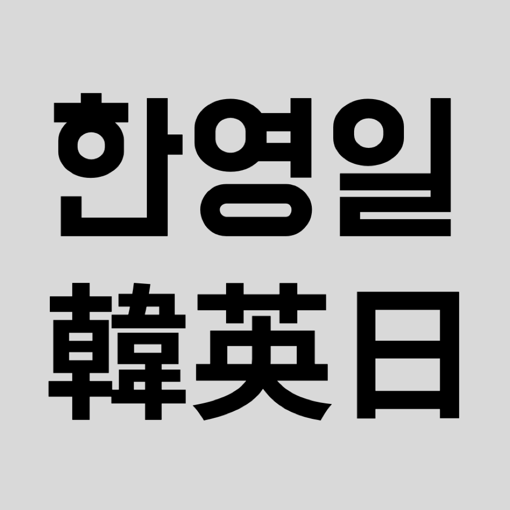

<p align="center">
  
</p>

<h1 align="center">KoEnJa</h1>

<p align="center"><b>한 자판으로 한·영·일 · 一つの配列で韓・英・日 · Korean, English, Japanese on one keyboard</b></p>

<p align="center">한영일(KoEnJa)은 한국어·영어·일본어를 언어 전환 없이 입력하는 키보드입니다.<br>
Mac 입력기, iOS 키보드, Android 키보드, Windows 입력기로 만들고 있습니다.</p>

<p align="center">
  <a href="https://github.com/studioCIZMO/KoEnJa/releases/latest"></a>
  <a href="https://github.com/studioCIZMO/KoEnJa/actions/workflows/windows.yml"></a>
  
  
  
  <a href="LICENSE"></a>
</p>

<p align="center"><a href="https://cizmo.net/KoEnJa/ko">웹사이트</a> · 한국어 · <a href="README.ja.md">日本語</a> · <a href="README.en.md">English</a></p>

<h3 align="center">한/영 키도, 일본어 전환도 누르지 않아도 됩니다.</h3>

<p align="center">
모든 글을 영문(QWERTY) 자판으로 치세요.<br>
KoEnJa가 <b>단어마다</b> 영어인지, 한국어(두벌식)인지, 일본어(로마자)인지 알아보고 맞는 글자로 넣습니다.
</p>

```
dhsmf ghldmldptj GitHub PR flqbfmf Rmxsorh mergegoTdjdy.  →  오늘 회의에서 GitHub PR 리뷰를 끝내고 merge했어요.
Please run the tests again before you push.               →  Please run the tests again before you push.
iPhonedetesutoshimashita⏎                                 →  iPhoneでてすとしました
kinouemailwookutta⏎                                       →  きのうemailをおくった
```

<sub>위 예는 엔진의 골든 테스트(`Android/engine/src/test/resources/golden.tsv`)에서 그대로 가져왔습니다. ⏎(Return)는 가나를 그대로 확정하고, Space는 한자로 변환합니다.</sub>

<p align="center">
  <a href="https://github.com/studioCIZMO/KoEnJa/releases/latest/download/KoEnJa-Mac.zip"></a>
  <a href="https://github.com/studioCIZMO/KoEnJa/releases/latest"></a>
  <a href="https://apps.apple.com/app/id6824875642"></a>
  <a href="https://play.google.com/store/apps/details?id=com.cizmo.koenja"></a>
</p>

<p align="center">
  <a href="https://github.com/studioCIZMO/KoEnJa/releases/latest"></a><br>
  <sub>휴대폰으로 스캔하면 다운로드 페이지가 열립니다</sub>
</p>

## 한눈에 보기

- **단어마다 알아서**: 영어, 한국어, 일본어 가운데 맞는 언어를 단어마다 고릅니다. 문장 중간에 언어가 바뀌어도 됩니다.
- **섞인 단어도**: `githubdp` → `github에`, `googlede` → `googleで`, `beautywo` → `beautyを`
- **틀리면 키 하나로**: 전환 키(iOS는 `한あA` 키)를 누르면 지금 단어가 다음 언어로 바뀝니다. Space로 확정한 직후에도 됩니다(`go` → `해`).
- **우선 언어**: 애매한 단어를 어느 언어로 읽을지, 한국어 우선과 日本語優先 가운데 고릅니다.
- **한자 변환**: Windows에서는 Microsoft IME처럼 Space·変換, F6–F10, Shift+←/→로 문절을 다룹니다.
- **세 플랫폼, 같은 판단**: Swift(iOS), Kotlin(Android), C++(Windows) 엔진이 같은 골든 테스트 1,950줄을 한 줄도 다르지 않게 통과합니다.
- **기기 안에서만**: 입력한 내용은 기기 밖으로 나가지 않습니다.
- **정확도 99.4%**: Araso의 평가 도구로 잰 값입니다(학습에 쓰지 않은 단어·구절 5,998개, 일본어 켬, [평가 결과](#평가-결과)).

## 목차

- [만든 이유](#만든-이유)
- [설치](#설치): [Mac](#mac) · [Windows](#windows) · [iOS](#ios) · [Android](#android)
- [키](#키): Mac([언어 바꾸기 키](#언어-바꾸기-키) · [오타 추측](#오타-추측) · [확정한 뒤에 고치기와 학습](#확정한-뒤에-고치기와-학습) · [텍스트 대치](#텍스트-대치) · [일시정지](#일시정지) · [vim](#vim)) · [Windows](#windows-1) · [iOS](#ios-1)
- [설정](#설정) · [설정 파일](#설정-파일)
- [판단 방식](#판단-방식) · [평가 결과](#평가-결과)
- [알려진 한계](#알려진-한계)
- [개발](#개발)
- [개인정보](#개인정보)
- [KoEnJa와 Araso](#koenja와-araso)
- [문제 보고](#문제-보고) · [코드 서명 정책](#코드-서명-정책) · [라이선스](#라이선스)

## 만든 이유

한국어·영어·일본어를 매일 섞어 쓰면 입력 소스가 셋이 되고, 전환 키를 누르는 일도 엉뚱한 언어로 쳐 버리는
일도 잦습니다. macOS에서는 [Araso](https://github.com/nyttastudio/araso)가 이 문제를 단어마다 언어를 알아보는
방식으로 풀었습니다. KoEnJa는 그 판단 엔진을 MIT 라이선스에 따라 빌려, Araso가 돌아가지 않는 iPhone, Android,
Windows에서 같은 방식으로 쓸 수 있게 만든 별도 제품입니다. 모든 기기에서 같은 엔진으로 쓰도록, Araso의 macOS 입력기를
바탕으로 한 Mac 버전도 함께 냅니다.

## 설치

### Mac

macOS 13 이상(Apple 실리콘, Intel). [릴리스](https://github.com/studioCIZMO/KoEnJa/releases/latest)에서 `KoEnJa.pkg`를 받아 열고 안내대로 설치하세요(0.3.14부터). 또는 터미널에서:

```sh
curl -fsSL https://raw.githubusercontent.com/studioCIZMO/KoEnJa/main/Mac/get.sh | sh
```

둘 다 `/Library/Input Methods`에 설치합니다(설치 패키지는 설치 때, get.sh는 그 폴더를 만드는 한 단계에서만 관리자 암호를 묻습니다; 이전의 `~/Library` 복사본은 옮겨 줍니다). `KoEnJa-Mac.zip`을 받아 풀어 `KoEnJa.app`을 `/Library/Input Methods`로 직접 옮겨도 됩니다. 그다음 시스템 설정 → 키보드 → 입력 소스 → 편집… → + → 한국어 → **한영일**을
추가합니다(목록에 없으면 한 번 로그아웃했다 다시 로그인). 앱과 설치 패키지는 CIZMO의 Developer ID로 서명하고 Apple 공증을 받았습니다.
Araso와 함께 설치해도 설정과 학습한 단어는 따로 둡니다(`~/Library/Application Support/KoEnJa`).
업데이트는 입력 메뉴의 「한영일 x.y.z로 업데이트…」나 설정 → 정보에서 합니다. 한국어 단어를 한 글자 잘못 쳤을 때 오른쪽 ⌥ 키를 길게 누르면 고친 후보를 보여 줍니다(설정 → 오타 고치기, 기본은 꺼짐). 소스는 `Mac/`에 있습니다.

<details>
<summary>완전 삭제</summary>

설정 창의 정보 탭 → **제거…** 가 가장 쉽습니다(「설정과 학습한 단어도 삭제」를 켜면 전부 지워집니다). 터미널에서는:

```sh
curl -fsSL https://raw.githubusercontent.com/studioCIZMO/KoEnJa/main/Mac/get.sh | sh -s -- --uninstall --delete-data
```

`--delete-data`를 빼면 설정과 학습한 단어(`~/Library/Application Support/KoEnJa`)는 남습니다. 둘 다 `/Library/Input Methods/KoEnJa.app`(과 옛 `~/Library/Input Methods/KoEnJa.app`), 설치 패키지의 영수증을 지우고 입력 소스에서도 빼며, 관리자 암호가 필요하면 macOS가 묻습니다.
손으로 지우려면(설정 창을 열 수 없을 때):

```sh
killall KoEnJa 2>/dev/null
sudo rm -rf "/Library/Input Methods/KoEnJa.app" "$HOME/Library/Input Methods/KoEnJa.app"
sudo pkgutil --forget com.cizmo.inputmethod.KoEnJa.pkg
rm -rf "$HOME/Library/Application Support/KoEnJa"      # 설정과 학습한 단어
defaults delete com.cizmo.inputmethod.KoEnJa 2>/dev/null  # 업데이트 확인 기록
killall TextInputMenuAgent 2>/dev/null
```

그 뒤 시스템 설정 → 키보드 → 입력 소스에서 한영일을 빼세요(목록에 남아 있으면 한 번 로그아웃했다 다시 로그인).
</details>

### Windows

1. [Releases](https://github.com/studioCIZMO/KoEnJa/releases/latest)에서 `KoEnJa-Setup-0.3.4.exe`를 받아 실행하세요.
2. 0.3.4는 아직 코드 서명이 없어 SmartScreen의 **Windows의 PC 보호** 화면이 나옵니다.
   **추가 정보** → **실행**을 누르고, 이어지는 관리자 권한 확인에서 **예**를 누르세요.
3. 마지막 화면에서 **KoEnJa 설정 열기**를 체크한 채 마치면 키보드 종류, 쓰는 언어, 전환 키를 고를 수 있습니다.
   나중에는 시작 메뉴의 **KoEnJa 설정**에서 바꿉니다.
4. **Win+Space**로, 또는 작업 표시줄 오른쪽의 언어 표시(한/あ/ENG)를 눌러 **KoEnJa**를 고르세요.

64비트 Windows 10/11(x64) 전용이고, ARM64 Windows는 아직 지원하지 않습니다. 한국어·일본어 입력 목록에 KoEnJa가
추가됩니다(둘 다 없으면 한국어에 추가합니다).

<details>
<summary>제거</summary>

설정 → 앱 → 설치된 앱 → **KoEnJa** → 제거. 입력 목록에서도 빠집니다. 쓰는 중인 앱이 있으면 일부 파일은 다시
시작할 때 지워집니다. 설정과 학습한 단어(`%LOCALAPPDATA%\KoEnJa`)는 남겨 두므로, 필요 없으면 그 폴더를 지우세요.

</details>

### iOS

[App Store](https://apps.apple.com/app/id6824875642)에서 받을 수 있습니다(iOS 16 이상, 무료).
설치한 뒤에는 앱에서 쓰는 언어의 순서를 고르고, 설정 → 일반 → 키보드에서 KoEnJa 키보드를 추가합니다.
**전체 접근 허용**은 앱에서 고른 언어 순서와 설정을 키보드가 읽고 햅틱을 쓰는 데 필요합니다([개인정보](#개인정보)).

### Android

[Google Play](https://play.google.com/store/apps/details?id=com.cizmo.koenja)에서 받을 수 있습니다(Android 8.0 이상, 무료). [릴리스](https://github.com/studioCIZMO/KoEnJa/releases/latest)의 `KoEnJa-Android-0.2.8.apk`로 설치할 수도 있습니다.
설치한 뒤 앱에서 「키보드 설정 열기」로 한영일을 켜고, 「입력 방법 고르기」로 고르세요.
Play 버전은 Google이 서명하므로, APK판에서 Play 버전으로 옮기려면 APK판을 지우고 Play에서 설치해 주세요. 소스는 `Android/`에 있습니다.

## 키

### Mac

치고 있는 단어에는 밑줄이 그어지고, KoEnJa가 예상한 언어로 보입니다.

| 키 | 영어·한국어 단어 | 일본어 구절 |
| --- | --- | --- |
| 글자 | 단어를 이어서 침 | 구절을 이어서 침 (가나로 미리 보기). `nn`은 늘 `ん`이라 `rennai` → れんあい, な행 앞의 ん은 n을 세 번(`konnnichiha`, `onnna`). Windows·Google 일본어 입력기와 같음 |
| Caps Lock을 켜고 친 글자 | Caps Lock이 꺼진 것처럼 판단(`GKAUS` → `하면`), 영어로 남으면 대문자(`OUTPUT`). 단어 전체가 낱자모이고 두 개 이상이면 영어(`RST`, `RD`, 채팅 자모 `ZZ`도). 사전에 넣거나 배운 단어는 사전대로. 단어 중간에 바꾸면 거기서 새 단어 | 같음 |
| **[언어 바꾸기 키](#언어-바꾸기-키)** (기본: 오른쪽 ⌥ 단독으로 눌렀다 떼기, ⇧Esc) | 읽기 바꾸기: 영어 → 영어+조사 → 한국어 → 일본어 | 같음 (라이브 변환이면 먼저 가나로) |
| 오른쪽 ⌥·오른쪽 ⇧(언어 바꾸기 키로 골랐을 때)를 0.5초 넘게 눌렀다 떼기 | [오타 추측](#오타-추측): 키 하나가 꼬였다면 무슨 단어였을지 | 아무 일 없음 |
| Esc | 확정하고 앱이 Esc를 받음 (언어 바꾸기 키로 골랐으면 위와 같음) | 라이브 변환이면 먼저 가나로, 가나에서는 구절 취소 (앱에는 가지 않음) |
| Delete | 영어는 한 글자씩. 한국어는 치고 있는 글자를 자모 하나씩, 그 앞은 한 글자씩 (한국 → 한구 → 한ㄱ → 한 → 지움, 시스템 두벌식과 같음) | 가나 한 글자씩 (かんこく → かんこ). 라이브 변환이면 마지막 문절이 가나로 돌아가며 한 글자 지워지고 앞 문절은 그대로 (今日はいい天気 → 今日はいいてん), 맥 일본어 입력기와 같음 |
| **Space** | 확정하고 띄어쓰기 | **한자로 변환** (후보 창) |
| `, . ? !` 등 기호 | 확정하고 그 기호 | 구절에 붙어 전각으로: 、。？！ （）＿ 「」(`[ ]`) ・(`/`) 〜(`~`) |
| `-` | 확정하고 `-` | ー |
| Return | 확정만 (줄바꿈·전송은 한 번 더, 설정에서 바꿀 수 있음) | 보이는 대로 확정: 가나, 라이브 변환이면 한자 (줄바꿈 없음) |
| ⌃K / F7, ⌃J / F6 | (앱의 단축키) | 가타카나 / 히라가나 (Space로 전환, Return으로 확정) |
| Tab, 방향키, ⌘/⌃/⌥ | 확정하고 앱이 그 키를 받음 (⌘은 누르는 순간 확정되어, ⌘V는 단어 뒤에 붙고 ⌘⌫ 같은 지우기도 이 단어를 건너뛰지 않음) | 같음 |
| **오른쪽 ⌘** (단독으로 눌렀다 떼기, 설정에서 바꿀 수 있음) | 이 입력창에서 [일시정지](#일시정지) / 다시 켜기 | 같음 |

<details>
<summary>변환 중 (후보 창이 열려 있을 때)</summary>

| 키 | 동작 |
| --- | --- |
| Space / ↓, ↑ | 다음 / 이전 후보 |
| ←, → | 첫 문절을 줄이기 / 늘리기 (`今日は｜いいてんき`) |
| 1–9 | 보이는 쪽의 그 번호 후보로 확정 |
| Return | 고른 후보로 확정 |
| Esc | 가나로 돌아가기 |
| Delete | 맥 일본어 입력기와 같음: 라이브 변환이 꺼져 있으면 보이는 변환에서 마지막 한 글자를 지우고 확정 (変換 → 変), 켜져 있으면 마지막 문절을 가나로 돌리며 한 글자 지우고 계속 치기 (今日はいい天気 → 今日はいいてん) |
| 글자, 문장부호 | 확정하고 이어서 치기 |

변환은 문절 단위입니다. 후보를 고르고 있는 문절에는 굵은 밑줄이, 나머지 읽기에는 가는 밑줄이 그어져서
←/→로 옮긴 경계가 보입니다(밑줄 모양을 따르지 않는 앱에서는 한 줄로 보입니다). 읽기의 앞부분만 덮는 후보(きょうはいいてんきですね의 `今日は`)를 고르면 그 부분만
확정하고 나머지를 계속 변환합니다. 후보 창에는 엔진이 주는 동음이의어가 모두 나옵니다. 드문 한자는 목록
뒤쪽에 있습니다(しょう의 `硝`). 후보 창은 언어 바꾸기 띠와 같은 종이에 세로로 문절 밑에 뜨고, 후보 글자가
문절과 같은 자리에서 시작합니다. 지금 고른 후보는 같은 파란 캡슐에 들어 있습니다. 한 쪽에 9개씩 번호가 붙고
아래에 읽기와 쪽 수가 나오며(`きょうは · 1/2`), 10번째 후보에서 다음 쪽이 아래에서 올라옵니다. 창 너비는 모든
쪽에서 가장 긴 후보에 맞춰서 쪽을 넘겨도 바뀌지 않고, 화면 아래쪽에서는 문절 위에 뜹니다. 눌러서 골라도 됩니다.

</details>

<details>
<summary>일본어 뒤의 기호와 숫자</summary>

일본어 다음에 따로 친 기호도 일본어 입력기처럼 전각으로 밑줄 친 채 남습니다(`！`, `＿`, `「`).

- Return으로 확정하고(줄바꿈 없음), Space로 다른 모양(`!`, `‼︎`, `『`…)을 고릅니다. 글자를 이어 치면 확정되고
  새 단어가 시작됩니다.
- 숫자 사이(`3.5`, `10:30`)는 반각 그대로입니다. 전각으로 연 괄호는 영어 단어 뒤에서도 전각으로 닫힙니다
  (`日本語（English）`).

일본어를 켜 두면 숫자와 기호도 일본어로 칠 수 있습니다.

- 문장 첫머리나 한국어·영어 뒤에서 따로 친 숫자나 기호는 반각으로 들어갑니다. 바로 언어 바꾸기 키를 누르면
  일본어 쪽 모양으로 밑줄 친 채 바뀝니다(`123` → `１２３`, `[` → `「`, `?` → `？`).
- 일본어 문장에서 숫자 바로 뒤에 붙여 친 단어는 조수사로 읽고, Space로 변환할 때 숫자까지 함께 변환합니다
  (`3ji` → `3時`, `5fun` → `5分`). `5km`, `3pm`처럼 로마자로 읽히지 않는 단위는 영어 그대로입니다.

</details>

#### 언어 바꾸기 키

읽기를 바꾸는 키는 설정 창의 **키**에서 키 모양 버튼을 눌러 고릅니다. 오른쪽 ⌥ 단독, ⌥Space, 오른쪽 ⇧ 단독,
Esc, ⇧Esc 중 여러 개를 고를 수 있고, 기본값은 **오른쪽 ⌥ 단독**과 **⇧Esc**입니다. 고르지 않은 키는 앱으로 갑니다.

누르면 단어 아래에 그 단어의 읽기가 세로 띠로 나옵니다(`dkssud`, `안녕`이 한 줄씩). ↓·↑로 다음·이전 읽기로 옮길 수 있습니다. 지금 보이는 읽기는 macOS가 입력 소스를
바꿀 때 캐럿 아래 띄우는 것과 같은 파란 캡슐에 들어 있고, 다른 읽기는 그 옆에 들어갈 글자 그대로 있어서 몇 번 더
누르면 무엇이 나오는지 보입니다. 읽기에는 번호가 붙어, 숫자를 누르거나 읽기를 클릭하면 한자 후보 창처럼 그 읽기로 정해집니다: 치는 중인 단어는 그 읽기로 확정되고(Return처럼 공백 없이, 언어 바꾸기 키로 다시 바꿀 수 있음), 확정한 단어는 그 읽기로 바뀝니다. 3벌식에서는 숫자 키가 자모라 치는 중인 단어에는 번호가 없습니다. 다른 키를 누르면 띠가 바로 사라집니다. 긴 읽기는 140pt에서
줄이고, 화면 아래쪽에서는 단어 위에 뜹니다. 움직임은 0.2초 안에 끝나고, 시스템 설정에서 동작 줄이기를 켜면 움직이지
않습니다.

- **오른쪽 ⌥ 단독, 오른쪽 ⇧ 단독**: 앱은 modifier 하나만 눌렀다 뗀 것에 반응하지 않으므로, 창을 닫거나 입력을
  지우지 않습니다. 다른 modifier와 함께 오면 받지 않으므로, Raycast나 Karabiner의 Hyper 키(⌃⌥⇧⌘를 한꺼번에)로
  바꾼 키는 원래 묶어 둔 동작을 합니다. 그럴 때는 다른 키를 고르세요.
- **⌥Space**: 원래 줄바꿈 없는 공백을 넣는 키라, 고르면 그 공백은 들어가지 않습니다.
- **Esc**: 손에 익었다면 빠릅니다. 다만 Claude 데스크톱이나 Slack 같은 Chromium 기반 앱은 입력기가 가져간 Esc도
  따로 받아서, 단어를 바꾸는 동시에 창을 닫거나 입력을 취소하기도 합니다. 바꿀 단어가 없으면 앱으로 갑니다.
- **⇧Esc**: 바꿀 단어가 없으면 아무 일도 하지 않고, 앱에도 가지 않습니다.

앱별 설정에서 앱마다 다른 키를 고를 수 있습니다. 예를 들어 기본으로는 Esc로 바꾸고, 편집기처럼 Esc가 앱에
가야 하는 곳에서만 Esc를 빼면 됩니다. 입력 메뉴의 "Esc로 언어 바꾸기"는 지금 앱에서 Esc만 넣고 뺍니다. 일본어
후보 창에서, 그리고 라이브 변환으로 한자가 떠 있을 때 Esc는 고른 키와 상관없이 먼저 가나로 돌아갑니다. 라이브
변환이 가나 그대로 보여 주는 구절(`たけ`)에서는 언어 바꾸기 키가 바로 언어를 바꿉니다.

#### 오타 추측

빠르게 치다 키 하나가 꼬이면(이웃한 두 키가 바뀌거나, 키가 빠지거나 한 번 더 눌리거나, Shift를 늦게 누르거나,
옆 키를 누르면) 한글로 조합할 때 낱자모가 남거나(`clekkr` → `치다ㅏㄱ`) 다른 글자가 됩니다(`djddj` → `엉어`).

- **오른쪽 ⌥(또는 오른쪽 ⇧, 언어 바꾸기 키로 골랐을 때)를 0.5초 넘게 눌렀다 떼면**(Esc·⇧Esc·⌥Space는 길게 눌러도 추측이 열리지 않습니다) 방금 확정한(또는 치던) 단어의 실수 하나를 되돌린 단어들이 한자
  후보 창 모양으로 뜨고, 첫 번째가 그 자리에 들어갑니다(`엉어` → `영어`). 누르는 동안 그 단어 아래에 빨간 물결이 그어져 언제 떼면 되는지 보이고, 추측에서 바뀐 글자는 색과 물결 밑줄로 보입니다. 다시 길게 누르거나 ↓·↑로 다른 추측,
  숫자·클릭·Return으로 고르고, Esc와 Delete는 원래대로 돌립니다. 다른 키를 누르면 보이는 대로 두고 이어집니다.
  추측이 없으면 "추측 없음"이 잠깐 뜹니다. 두벌식에서만 동작하고, 실수는 하나까지만 봅니다.
  macOS Terminal에서는 목록이 열린 동안 추측이 밑줄 친 채로 있다가 고르면 들어갑니다. `cat`처럼 셸 프롬프트가 아닌 곳에서는 Space 뒤 단어를 바꿀 때 화면이 깨져 보일 수 있지만, 줄 내용은 맞습니다.
  Ghostty처럼 글자를 읽어 주지 않는 앱에서는 치던 단어에만 추측이 뜹니다. Space 뒤 단어는(`holdSpace`로 밑줄에 남겨 둔 단어도) 바꿀 수 없어 "추측 없음"이 뜹니다.
- **오타 고치기**(설정의 키 → 오타 고치기, `fixSlips`, 기본 꺼짐)를 켜면 확실한 경우에는 단어를 끝낼 때(Space,
  문장부호) 바로 고쳐 넣고 "✦ 오타 고침"을 잠깐 보여 줍니다(`clekkr` → `치다가`). 친 그대로 조합하면 낱자모가
  남거나 아무도 쓰지 않는 음절이 있고(음절로만 된 단어는 받침의 Shift 실수만: `햇어요` → `했어요`), 영어로 보이지 않고,
  채팅 자모로 끝나지 않고(`고마워ㅠ`), 첫 추측이 다른 추측보다 훨씬 흔한 단어일 때만 고칩니다. URL·경로 안,
  엄격하게 앱, 사전이 아는 키, 언어 바꾸기 키로 고른 단어는 고치지 않습니다.
- 고친 직후 **Delete**를 누르면 띄어쓰기는 그대로 두고 친 그대로 돌아갑니다. 그대로 두고 다음 단어를 치면(또는
  언어 바꾸기 키로 다른 읽기로 바꾸면) 그 키는 사전에 남아 다음부터 고치지 않습니다. 이어서 지우면 아무것도
  배우지 않습니다. 고친 대로 두면 아무것도 배우지 않습니다.
- 사전이 기억하는 키에서 추측을 직접 고르면 그 기억을 지웁니다("원래대로"). 다음부터 다시 고칩니다.

#### 확정한 뒤에 고치기와 학습

Space나 문장부호로(또는 Return으로 밑줄만) 단어를 확정한 직후 언어 바꾸기 키를 누르면 그 단어가 다음 읽기로 바뀌고, 더 누르면 계속
돌아갑니다. 문장부호 뒤에 기호·숫자나 공백을 더 친 뒤(`world. `, `world?! `, `안녕.12`)나 Delete로 공백이나 문장부호를 지운
뒤에도 바꿀 수 있지만, 그 밖의 키를 하나라도 누르면 고칠 수 없습니다. 커서가 그 단어 바로 뒤에 있고, 앱이 그 자리의 글자를 알려 줄 때만 됩니다. 바꾼 직후 띠의 읽기에는 번호가
붙어, 숫자를 누르면 그 읽기로 바로 바뀌고 띠가 닫힙니다. 띠에서 클릭해 골라도 같고(지금 읽기를 클릭하면 그대로 닫힘), Return은 지금 읽기로 띠만 닫습니다(줄은 바뀌지 않음). 그 뒤 ←/→는 커서를 옮깁니다(바꾸지 않았을 때의 숫자는 그대로 들어갑니다).

같은 줄의 지난 단어도 고칠 수 있습니다. 커서를 그 단어 어디에든 두고(클릭, ⌥←·⌥→) 오른쪽 ⌥를 눌렀다 떼면(⇧Esc,
⌥Space를 골랐다면 그 키도) 그 단어만 다시 밑줄로 돌아와 다음 읽기로 바뀌고, 커서는 그 단어 끝에 갑니다. 뒤의
단어는 그대로입니다. 필드 맨 앞 단어도 같습니다. macOS의 텍스트 칸은 밑줄을 커서 자리에만 두어서 커서를 단어 앞으로
옮겨야 하는데, 맨 앞에서는 앞 글자 대신 폭 없는 공백을 잠깐 넣었다가 고치기가 끝나면 지웁니다. 더 누르면 계속 돌아가고, 일본어 변환처럼
굵은 밑줄이 지금 고치는 부분입니다. →를 누르면 키 하나씩 늘어나다가 단어 끝을 넘으면 다음 단어까지 함께 바뀌고(`dkssud gktpdy`
→ `안녕 하세요`, 밑줄도 다음 단어까지 넓어짐), ←를 누르면 줄어들다가 단어 안에서 끊으면 남은 키는 따로 읽습니다(`hellofmf` → `hello`+`를`). ←로 뺀 단어는 원래대로 돌아가지만
가는 밑줄은 남습니다.
범위를 바꾸면 아래 띠의 읽기도 지금 고치는 부분(굵은 밑줄)의 것으로 바뀝니다. 띠의 읽기에는 번호가 붙고, 숫자를
누르거나 읽기를 클릭하면 그 읽기로 정하고 Return처럼 넘어갑니다(한자 후보 창처럼): 끊은 앞부분이면 그 부분이 정해지고 남은 키를 고치고, 아니면 고치기가 끝납니다. 끊은 앞부분에서 Return을 누르면 그
부분이 정해지고 남은 키를 고칩니다. ⇧←/⇧→는 범위의 앞쪽 끝을 옮기고(한글은 글자, 가나는 한 자 단위), 앞에 남은 부분은 처음 들어간 대로 둡니다. 혼합 단어의 한국어 부분이나 한자 안으로는 들어가지 않습니다. 앞쪽 끝을 옮긴 뒤에는 ←/→도 뒤에 남는 부분이 처음 들어간 대로일 때만 멈춥니다. ←와 함께 쓰면 단어 가운데만 고칩니다(`hellodkssudworld`에서 ⇧→ 5번, ← 5번 → `hello`|`안녕`|`world`). 앞쪽 끝은 첫 단어 안에서만 움직이니, 그 앞 단어까지 고치려면 그 단어에서 시작해 →로 늘립니다. 치는 중인 단어도
같은 식으로 끊을 수 있습니다. 단어 하나를 통째로 일본어로 고쳤다면 Space로 한자 후보 창이 열리고, 치는 중인 단어처럼 고릅니다(Space·↑↓로 후보, ←/→로 문절 크기, Return·숫자로 고르면 고치기도 끝, Esc는 가나로). 언어 바꾸기 키로 읽기를 바꾼 뒤에는 ←/→가 바로 범위를 바꾸고, 그 전에는 ⇧←로 키 하나를 끊으며 시작합니다(`helloab`에서
⇧←← → `hello`|`ab`; 바꾸기 전의 ←는 전처럼 단어를 넣고 커서를 옮깁니다). Space나 Return으로 확정한 직후의 단어도 언어 바꾸기 키로 바꾼
뒤 ←/→를 누르면(→는 그 단어가 줄 끝일 때만) 밑줄이 쳐져 같은 식으로 고칩니다(바꾸기 전이라면 ⌥←로 단어 앞에 가서 언어 바꾸기 키). Return이나 다른 키를 누르면 고친 대로
들어가고, 커서는 치던 줄 끝으로 돌아갑니다(⌘Z는 두 번: 한 번은 줄 끝까지를 선택하고, 한 번 더 누르면 고치기 전으로). 줄의 마지막 단어를 통째로 고쳤다면(끊은 단어는 빼고) 그 직후 언어 바꾸기 키로 방금 확정한 단어처럼 다시 바꿉니다. Esc(언어 바꾸기 키로 고르지 않은 앱에서)와 Delete는 손대기 전으로
되돌립니다. 치던 단어는 바꾸기 전 읽기로 다시 치는 중이 되고, 방금 확정한 단어는 처음 들어간 대로 돌아가 언어 바꾸기 키로 다시 바꿀 수 있습니다. 밑줄에는
단어만 들어가고 뒤의 공백·기호는 들어가지 않습니다(3벌식 기호처럼 읽기를 따라 바뀌는 것과, 확정 직후 쉼표+공백처럼
커서 자리 때문에 함께 다뤄야 하는 것은 빼고). 통째로 고친 단어는 확정 직후에 고친
것처럼 학습하고, 끊은 단어는 학습하지 않습니다. Return을 누르면 그 위의 줄은 고칠 수 없고, 그 사이에 손으로 바꾼 단어도 고치지
않습니다.

한 번 고친 단어는 다음부터 그쪽으로 조금 기웁니다. 애매한 단어(`so`/`내`)만 바뀌고 확실한 단어는 그대로라,
실수로 바꾼 것이 크게 남지 않습니다. 30일 동안 다시 고치거나 그대로 치지 않으면 잊습니다. 같은 키를 같은 쪽으로
두 번 고치면 그때부터 늘 그렇게 쓰고(뒤에 조사가 붙어도: `ghostty`를 기억하면 `ghostty에`), KoEnJa가 고른 쪽으로 되돌리면 잊습니다. 기억한 단어를
또 다른 읽기로 바꾸면 한 번은 기억이 그대로이고, 같은 읽기로 한 번 더 바꾸면 그 읽기를 기억합니다.
언어 바꾸기 띠에서 읽기 뒤의 체크(✓)는 사전이 기억한 읽기(두 번 고쳤거나 사전에 직접 등록한 단어), 연필(✎)은
한 번 고친 읽기입니다. 고친 뒤 다음 글자를 치면 띠 자체가 줄어들어 고른 읽기의 캡슐이 되고, 단어 첫 글자 아래에서 무슨 일이
있었는지 말합니다. 한 번 고치면 연필과 **한 번 고침**, 두 번 고쳐 기억하면 체크가 그려지며 **기억함**, KoEnJa가 고르는
쪽으로 되돌려 잊으면 되돌림 화살표(↺)와 **원래대로**(회색)이고, 잠시 뒤 사라집니다. 바뀐 것이 없으면 띠만 닫힙니다.
어떤 단어가 사전 때문에 그렇게 들어갔는지 궁금하면 입력 메뉴의 **사전이 바꾼 단어**를 보세요. 사전이 최근에
결정한 단어 5개가 `ghostty → 영어`처럼 나오고, 고르면 그 단어를 잊습니다(이 목록은 입력기가 다시 시작하면
사라지고, 어디에도 저장하지 않습니다). 잘못 기억했다면 입력 메뉴의
**마지막 학습 취소**를 누르세요. 문장을 통째로 바꾼 것처럼 긴
토큰(20키 넘게)은 기억하지 않습니다.

<details>
<summary>터미널처럼 고칠 수 없는 앱에서: Space·문장부호 뒤에도 단어 유지</summary>

터미널처럼 그 자리의 글자를 알려 주지 않는 앱에서는 입력 메뉴나 설정 창의 **앱별**에서 **Space·문장부호
뒤에도 단어 유지**를 켜세요(`apps.json`의 `holdSpace`). Space나 문장부호(`. , ? !` 같은 기호 전부, 숫자는 제외)가
단어를 끝내지 않고, 그 글자까지 밑줄 안에 넣습니다.

- 밑줄 친 동안은 치는 중인 단어와 같습니다. 언어 바꾸기 키로 바꾸고(`dkssud.` → `안녕.`, 부호는 친 그대로)
  Delete로 지울 수 있습니다(공백이나 부호가 먼저 지워집니다).
- 다음 단어를 치기 시작하면 그 글자와 함께 들어갑니다. ⌘ 키를 누르는 순간에도 들어가므로(밑줄 친 단어는
  어느 앱에서든 그렇습니다), ⌘V로 붙여넣으면 단어 뒤에 붙고, ⌘⌫ 같은 지우기도 이 단어를 건너뛰고 그 앞을 지우지 않습니다(터미널은
  ⌘V·⌘⌫을 KoEnJa에 보여 주지 않고 직접 처리합니다). 그 뒤에는 언어 바꾸기 키로 그 단어를 바꿀 수 없습니다.
- 잡아 두는 글자는 하나뿐입니다. `안녕.` 뒤의 Space나 두 번째 부호는 단어를 확정하고, 잡아 두지 않을 때처럼
  처리됩니다(보통은 앱으로 가고, 일본어로 들어간 단어 뒤에서는 일본어 글 뒤의 기호 규칙을 따릅니다).
- Return은 다른 밑줄 친 단어처럼 확정만 합니다(`returnConfirmsOnly` 기본값). 줄을 바꾸거나 명령을 실행하려면 한 번 더
  누르세요. 그 설정을 끄면 첫 Return에 줄이 바뀌거나 명령이 실행됩니다.
- 앱이 Space 키를 받지 않으므로, 그 앱에서는 텍스트 대치가 동작하지 않습니다.

</details>

#### 텍스트 대치

시스템 설정 → 키보드 → 텍스트 대치에 넣은 약어 중 한국어·일본어로 읽히는 것(`주소`, `ㅈㅅ`, `よろ`)은 판단과
상관없이 그 언어로 보입니다. 그래서 Space를 치면 앱이 시스템 입력기에서처럼 바꿉니다. 영어 약어는 원래대로
판단합니다.

- 일본어 약어는 Space를 누르면 대치할 문구가 첫 후보로 나옵니다. 같은 약어를 여러 번 넣었다면 문구가 모두
  차례로 나옵니다. 히라가나 읽기로 넣으세요(`よろ`, `ぐー`).
- 한국어·영어 약어도 여러 번 넣었다면(문구가 둘 이상) Space를 누를 때 같은 후보 창에 문구가 모두 나오고, 마지막에
  약어 그대로가 나옵니다. 고르면 문구와 띄어쓰기가 들어가고, Esc를 누르면 약어로 돌아갑니다. 문구가 하나면
  지금처럼 앱이 바꿉니다(macOS는 약어마다 문구를 하나만 앱에 넘깁니다).
- 바꾸는 건 앱이라, 텍스트 대치를 지원하지 않는 앱(터미널, Chrome 등)에서는 후보 창에서 고른 문구 말고는 바뀌지
  않습니다.
- 목록을 고치면 다음에 입력창을 누를 때 반영됩니다.

#### 일시정지

터미널의 lazygit, htop처럼 키 하나하나가 명령인 곳에서는 **오른쪽 ⌘**를 단독으로 눌렀다 떼세요. 치던 단어를
확정하고, 그 입력창에서는 키를 친 그대로 넘깁니다. 한 번 더 누르거나, 다른 앱·입력창으로 가거나, 설정을 바꾸면
다시 켜집니다.

누를 때마다 입력 소스를 바꿀 때처럼 커서 아래에 「한」이 잠깐 뜨고, 일시정지하면 회색 바탕에 빗금이 쳐져
있습니다. 메뉴 막대 아이콘은 바뀌지 않으므로, 나중에 확인하려면 입력 메뉴의 체크 표시를 보세요.

일시정지 키는 설정 창의 **키**에서 바꿉니다. 오른쪽 ⌘·⌥·⇧·⌃ 중 하나를 단독으로 누르거나, 단축키(⌃⌥P처럼
⌘·⌃·⌥가 들어간 조합, 또는 F 키 하나)를 기록하거나, 끌 수 있습니다. 언어 바꾸기 키로 쓰는 키(오른쪽 ⌥·⇧,
⌥Space)와 히라가나·가타카나 키(⌃J·⌃K, F6·F7)는 고를 수 없습니다. 앱 메뉴에 같은 단축키가 있으면 앱이 먼저
가져갈 수 있습니다.

#### vim

neovim은 [`Mac/vim/koenja.lua`](Mac/vim/koenja.lua)를 `~/.config/nvim/plugin/`에, Vim(8.2 이상,
`+job`)은 [`Mac/vim/koenja.vim`](Mac/vim/koenja.vim)을 `~/.vim/plugin/`에 넣으세요.

vim이 모드가 바뀔 때마다 KoEnJa에 알려 주므로, 입력 모드에서만 단어를 판단하고 노멀·비주얼·명령줄 모드에서는
키를 바로 vim에 보냅니다. `s`, `dd`, `ciw`, `:wq⏎`가 키마다 바로 실행됩니다. vim 안에서는 Esc가 늘 vim으로
가므로 앱별 설정은 필요 없고, vim을 끝내면 셸에서 다시 단어를 판단합니다.

<details>
<summary>동작 방식과 주의할 점</summary>

- 신호는 `KoEnJa --vim insert|normal|off --app <번들 ID>`입니다. 키마다가 아니라 모드가 바뀔 때(입력 모드
  들어가기·나오기, 시작, 끝, 포커스)만 보냅니다.
- 번들 ID는 macOS가 앱마다 넣어 주는 `$__CFBundleIdentifier`입니다. 그래서 터미널(Ghostty, Terminal, iTerm2,
  VS Code 등)마다 따로 설정할 것이 없고, 신호는 그 앱의 입력창에만 갑니다. `--app` 없는 신호는 Esc가 언어 바꾸기
  키가 아닌 앱에서만 받습니다.
- tmux 서버를 띄운 터미널과 다른 터미널에서 붙으면 번들 ID가 달라 신호가 무시됩니다.
- Vim이 터미널의 포커스 변화를 모르면, vim 패널에서 셸 패널로 옮겨도 KoEnJa는 알 수 없습니다. 그럴 때는
  ⇧Esc(언어 바꾸기 키로 골랐을 때)를 누르면 다시 단어를 판단합니다.

</details>

### Windows

| 키 | 하는 일 |
| --- | --- |
| 전환 키 (입력 중) | 지금 단어를 다음 언어로 바꿉니다. |
| 전환 키 (입력 중이 아닐 때) | 세 언어를 다 쓰면 우선 언어를 바꿉니다(**한국어 우선 ↔ 日本語優先**). 한국어+English나 日本語+English만 쓰면 KoEnJa를 켜고 끕니다(끄면 그냥 영어). |
| Space · 変換 | 일본어를 한자로 변환합니다. 한 번 더 누르면 후보 목록이 열립니다. |
| Space · Tab · ↓ / Shift+Space · ↑ | 후보 목록에서 다음 / 이전 후보. PageDown·PageUp은 페이지 단위. |
| 1–9 | 목록의 후보를 고릅니다. |
| Return | 전부 확정합니다. 변환 전이면 가나 그대로 확정합니다. |
| Esc · Backspace | 변환을 취소하고 가나로 돌아갑니다. |
| Shift+← / Shift+→ | 첫 문절을 줄이거나 늘립니다. →는 첫 문절을 확정하고 나머지를 변환합니다. |
| F6 · F7 · 無変換 | 히라가나 · 가타카나 · 둘 사이 바꾸기 |
| F8 · F9 · F10 | 반각 가타카나 · 전각 영문 · 반각 영문 |
| 半角/全角 (일본어 키보드) | KoEnJa 켜기·끄기 |

**전환 키 기본값**은 한국어/미국식 키보드에서 오른쪽 Alt 단독 탭(= 한/영), 일본어(JIS) 키보드에서 無変換입니다.
KoEnJa 설정에서 왼쪽 Ctrl 단독 탭, 한/영, 変換, 無変換, Ctrl+Shift 탭, Shift+Space, Ctrl+Space 가운데 고를 수
있습니다. Ctrl+Shift를 쓰려면 Windows의 Ctrl+Shift 키보드 레이아웃 전환 단축키를 꺼야 합니다
(설정 > 시간 및 언어 > 입력 > 고급 키보드 설정 > 입력 언어 바로 가기 키).

### iOS

- **`한あA` 키**: 지금 단어를 다음 언어로 바꿉니다. Space로 확정한 직후에 누르면 방금 넣은 단어를 바꿉니다.
- 쓰는 언어와 그 순서는 앱에서 고릅니다. 앞에 둔 언어가 애매한 단어를 가져갑니다.
- 일본어를 치는 동안 후보 막대에 변환 후보가 나오고, 확정한 뒤에는 이어질 말을 보여 줍니다.
- **추천과 교정**(앱 설정): 추천 단어, 자동 고침, 가장자리 터치 보정, 다음 단어 예측을 하나씩 끌 수 있습니다. 끈 기능은 계산하지 않아 입력이 가벼워집니다.

## 설정

Mac 입력기의 설정입니다(iOS·Android·Windows는 각 앱의 설정 화면). 입력 메뉴(한영일을 고른 상태의 메뉴 막대)에서 할 수 있는 것:

- 이 입력창에서 일시정지(일시정지 키와 같음)
- 지금 앞에 있는 앱의 단어 변환 켜고 끄기, 그 앱의 변환 기준(보통·엄격하게), Esc로 언어 바꾸기, Space·문장부호
  뒤에도 단어 유지, 이 앱에서 일본어 입력, 그 앱을 기본 설정으로 되돌리기. 단어 변환이 꺼져 있으면 이 항목들은
  흐리게 나옵니다
- 일본어 입력(기본값, 앱마다 따로 정하지 않은 앱 전부)과 라이브 변환 켜고 끄기
- 마지막으로 학습한 단어 되돌리기, 사전이 최근에 바꾼 단어 보고 잊기, 입력해 보기, 사전, 설정 창 열기

설정 창에는 아래 탭이 있고, 바꾼 내용은 바로 적용됩니다.

| 탭 | 내용 |
| --- | --- |
| 언어 | 단어 변환 켜고 끄기, 일본어 켜고 끄기, 자판 카드(한글: 두벌식·세벌식 최종·세벌식 390, 영문·로마자: QWERTY·Colemak·Colemak-DH), 일본어 입력과 그 옵션, 한자 후보 순서 초기화 |
| 키 | 언어 바꾸기 키, Return, 일시정지 키 |
| 앱별 | 변환 기준(보통·엄격하게)과 앱마다 다른 동작: 일본어, 언어 바꾸기 키, Space·문장부호 뒤 (`apps.json`) |
| 사전 | 등록한 단어와 학습한 단어를 한 목록으로 (`dictionary.json`): **+**로 키를 쳐서 영어·한국어·일본어 중 읽기와 앱을 정해 추가하고, 학습한 단어는 줄 끝의 ⋯에서 등록으로 고정하거나 지우기. 한 번 고친 단어는 잊힐 때까지 남은 기간도 보여 줌 |
| 입력해 보기 | 단어마다 어떻게 판단했는지와 점수, 그 키를 사전에 추가 |
| 정보 | 버전, 바뀐 것, 업데이트, 제거 |

### 설정 파일

메뉴와 설정 창 모두 `~/Library/Application Support/KoEnJa/`의 JSON 파일에 씁니다. 직접 고쳐도 되고, 없는
항목이나 형식이 틀린 값(`"true"`처럼 따옴표 친 값)은 기본값을 따릅니다. JSON으로 읽을 수 없는 파일은 덮어쓰지
않고 `settings.json.unreadable`처럼 옮겨 둡니다(`apps.json`, `dictionary.json`도 같습니다). 파일을 직접 고친
뒤에는 입력기를 다시 시작하세요: `pkill -x KoEnJa`.

<details>
<summary><code>settings.json</code>: 전체 설정</summary>

```json
{ "japanese": true, "liveConversion": true }
```

| 항목 | 기본값 | 내용 |
| --- | --- | --- |
| `japanese` | **꺼짐** | 로마자 일본어를 알아보고 변환합니다. |
| `liveConversion` | 꺼짐 | 일본어 구절을 치는 동안 가장 앞선 한자 후보를 보여 주고(`今日はいい天気でs`), Return을 누르면 보이는 대로 확정합니다. macOS의 실시간 변환과 같습니다. |
| `returnConfirmsOnly` | 켜짐 | 밑줄 친 단어에서 누른 Return은 확정만 합니다. 끄면 앱도 그 Return을 받습니다(일본어 구절은 그대로 확정만). |
| `fixSlips` | 꺼짐 | 키 하나가 꼬여 한국어로 읽히지 않는 단어를 단어 끝에서 원래 단어로 고칩니다([오타 추측](#오타-추측)). 바로 Delete를 누르면 되돌립니다. |
| `pauseKey` | `"rightCommand"` | 일시정지 키([일시정지](#일시정지) 참고). `"rightCommand"`·`"rightOption"`·`"rightShift"`·`"rightControl"`은 그 키 단독, `"off"`는 끔, 단축키는 `{ "keyCode": 35, "modifiers": ["control", "option"], "key": "P" }`처럼 씁니다. 예전의 `"rightCommandPause": false`는 `"off"`로 읽습니다. |
| `fullWidthDigits` | 꺼짐 | 일본어 뒤의 숫자를 전각으로 씁니다(`１２３`, 주소·전화번호의 `０３－１２３４`). 밑줄 친 채 남고, Space로 `123`(반각)이나 `三月` 같은 변환을 고릅니다. |
| `fullWidthSpace` | 꺼짐 | 일본어 뒤의 Space를 전각 공백(`　`)으로 씁니다. ⇧Space는 설정과 반대 폭의 공백을 넣습니다(꺼져 있으면 전각). |
| `latinLayout` | `"qwerty"` | 영어와 일본어 로마자를 치는 자판. `"colemak"`·`"colemakDH"`도 됩니다. 한글은 영문 자판과 상관없이 늘 같은 자리(QWERTY의 키)에 있습니다. 자판을 바꾸면 학습한 단어는 키가 달라져 새로 익힙니다. |
| `japaneseLayout` | 없음 | 일본어 로마자를 치는 자판(`"qwerty"`·`"colemak"`·`"colemakDH"`). 없으면 `latinLayout`을 따릅니다. 예를 들어 영어는 Colemak, 로마자는 QWERTY로 칠 수 있습니다. |
| `koreanLayout` | `"dubeolsik"` | 한글 자판. `"sebeolsikFinal"`은 세벌식 최종, `"sebeolsik390"`은 세벌식 390입니다. 숫자·기호 키의 자모(갔의 ㅆ은 2, 밥의 ㅂ은 ;)는 단어 안에서 글자에 맞을 때만 자모로 읽고, 아니면 그 기호를 넣습니다(안녕! 의 !). 숫자만 친 것은 숫자로 두되, 한국어 뒤의 00은 ㅋㅋ로 읽습니다(그 밖의 ㅋㅋ·ㅠㅠ(55)는 전환 키로). 세벌식에서 숫자·기호가 나오는 자리(최종의 ⇧B ?, ⇧/ !, ⇧H 0, [ (, 390의 ⇧B !, ⇧M 1)는 한국어 단어에 바로 붙여 칠 때와 그 뒤로 이어지는 기호에서 세벌식대로, 그 밖에서는 QWERTY대로 칩니다(Bob). 전환 키를 바로 누르면 친 글쇠로 돌아갑니다(지냈어? → ldhr2jtB). |
| `japaneseEngine` | `"apple"` | 한자 변환 엔진. `"apple"`은 macOS 일본어 입력기의 엔진을, `"azooKey"`는 앱에 든 AzooKey를 씁니다. |
| `checkForUpdates` | 켜짐 | 하루에 한 번 GitHub에 최신 릴리스 버전을 묻습니다(다른 것은 보내지 않습니다). 새 버전이 있으면 입력 메뉴와 정보에 알려 줍니다. |
| `displayLanguage` | 없음 | 설정 창과 입력 메뉴의 언어(`"en"`·`"ko"`). 없으면 시스템 언어를 따릅니다. |

라이브 변환에서:

- Space는 다음 후보부터 후보 창을 엽니다. 화면에 가나가 그대로 있으면(`しょう`) 첫 변환(`翔`)부터 엽니다.
- Esc는 가나를 보여 줍니다. 한 번 더 누르면, Esc가 언어 바꾸기 키일 때는 언어를 바꾸고, 아닐 때는 macOS
  일본어 입력기처럼 치던 구절을 취소합니다(앱에는 가지 않습니다).
- 짧은 읽기는 한자로만 바뀝니다(`と`는 그대로, `私`는 변환).
- 맨 앞 후보는 짧은 구절 5개 중 4개, 문장 전체 4개 중 3개꼴로 맞습니다([평가 결과](#평가-결과)).
  Return 전에 한번 확인하세요. 변환은 키마다 8–21 ms 걸립니다.

</details>

<details>
<summary><code>apps.json</code>: 앱별 동작</summary>

`"*"`는 모든 앱의 기본값이고, 앱(번들 ID)에는 기본값과 다른 항목만 적습니다. `.`으로 끝나는 키는 앞부분이 같은
앱 전부에 맞고, 여러 개가 맞으면 가장 긴 것을 씁니다. 직접 넣지 않으면 어떤 앱도 들어 있지 않습니다.

```json
{ "*":                     { "switchKeys": ["escape", "shiftEscape"] },
  "com.microsoft.VSCode":  { "switchKeys": ["rightOption", "shiftEscape"] },
  "com.apple.Terminal":    { "conversionThreshold": 0.97 },
  "com.example.Game":      { "enabled": false } }
```

| 항목 | 기본값 | 내용 |
| --- | --- | --- |
| `enabled` | `true` | `false`면 모든 키를 그대로 넘깁니다(영어만 입력). |
| `conversionThreshold` | `0.5` | 이만큼 확신할 때만 친 영문을 다른 글자로 바꿉니다. `0.97`(엄격하게)은 터미널에서 짧은 셸 명령이 한글로 바뀌지 않게 하고, `0.5`는 글을 쓸 때 한국어를 더 많이 바꿉니다. |
| `switchKeys` | `["rightOption", "shiftEscape"]` | 읽기를 바꾸는 키([언어 바꾸기 키](#언어-바꾸기-키)). `"rightOption"`(오른쪽 ⌥ 단독), `"optionSpace"`(⌥Space), `"rightShift"`(오른쪽 ⇧ 단독), `"escape"`(Esc), `"shiftEscape"`(⇧Esc). 고르지 않은 키는 앱으로 갑니다. 0.1.8까지 쓰던 `escapeToApp`은 읽어서 옮깁니다. |
| `holdSpace` | `false` | Space나 문장부호(숫자 제외)가 단어를 끝내지 않고 그 글자까지 밑줄 안에 넣습니다. 치는 중인 단어처럼 언어 바꾸기 키로 바꾸고 Delete로 지울 수 있고, 다음 단어를 치면 그 글자와 함께 들어갑니다. 확정한 단어를 고칠 수 없는 터미널용이니 앱별로 정하세요(`"*"`에 두면 모든 앱에서 그렇게 됩니다). Return은 `returnConfirmsOnly`대로 동작하고(기본값은 확정만), 텍스트 대치는 동작하지 않습니다. |
| `fullWidth` | `true` | `false`면 이 앱에서는 전각 숫자·공백 설정을 따르지 않고 반각으로 씁니다(터미널, 코드 편집기용). |
| `japanese` | 없음 | 이 앱의 일본어. 없으면 `settings.json`의 `japanese`를 따르고, `false`면 일본어를 켜 두어도 이 앱에서는 한국어·영어로만 가리고(변환·라이브 변환도 없음), `true`면 일본어를 꺼 두어도 이 앱에서는 씁니다. 앱별로만 정합니다. |

</details>

## 판단 방식

KoEnJa의 판단은 [Araso](https://github.com/nyttastudio/araso)의 엔진에서 왔습니다. 자세한 원리는
[Araso의 판단 방식](https://github.com/nyttastudio/araso#판단-방식)을 보세요. 짧게 정리하면 이렇습니다.

- 같은 키를 영어, 한국어(두벌식), 일본어(로마자 → 가나)로 각각 읽고 점수를 매깁니다.
  영어는 글자 3-그램과 SCOWL 단어 목록, 한국어는 음절 빈도와 단어 목록, 일본어는 가나 3-그램을 씁니다.
- 대문자, 숫자, URL·경로 같은 규칙과 앞 단어의 언어를 함께 봅니다. 앞 단어와 다른 언어로 바꿔 치는 경우도 고려합니다.
- 영어 단어 + 한국어 조사(`githubdp` → `github에`), 영어 단어 + 일본어(`googlede` → `googleで`)처럼 섞인 단어는 나눠서 읽습니다.
- 우선 언어는 애매한 단어에서 그 언어 쪽으로 점수를 조금 더 줍니다.

KoEnJa가 바꾼 점은 `Packages/SeamtypeCore/UPSTREAM`에 적고 코드에 `// REA:`로 표시했습니다. 한국어 단어 목록을
해시로 들고 있어 메모리를 줄인 것, 화면에 보인 그대로 확정하는 것, 대문자로 시작하는 영어 단어 뒤 일본어,
주소 뒤 조사와 URL 속 점 파일 같은 규칙입니다.

## 평가 결과

Araso의 평가 도구(`tools/prepare.sh`, `eval_convert.py`, `eval_context.py`)를 그대로 써서, 같은 Mac에서 같은 데이터로
Araso 원본(22e7d3d)과 KoEnJa 엔진을 나란히 쟀습니다(2026-10-23, Apple M4, macOS 26.7.2). 전체 표, 명령, 데이터
해시는 [docs/evaluation.md](docs/evaluation.md)에 있습니다. 엔진을 Araso 0.3.1(eee3cbd)로 올린 뒤(2026-10-26) 같은 방법으로
다시 쟀고, 아래 언어 판단과 한자 변환 수치는 Araso 0.3.1과 KoEnJa 모두 그대로였습니다.

**학습에 쓰지 않은 데이터** (영어 단어 2,011개, 한국어 단어 1,987개, 일본어 구절 2,000개)

| | Araso README (공개값) | Araso 22e7d3d (이 Mac) | KoEnJa 엔진 (이 Mac) |
| --- | --- | --- | --- |
| 일본어 끔 (영/한) | 99.82% | 99.77% | 99.77% |
| 일본어 켬 (영/한/일) | 99.50% | 99.40% | 99.40% |

두 엔진은 5,998개 모두에서 같은 답을 냈습니다. 일본어 켬에서 영어 99.25%, 한국어 99.80%, 일본어 99.15%입니다.

**한자 변환** (맨 앞 후보가 원문과 정확히 같은 비율, 학습에 쓰지 않은 Tatoeba 문장 400개씩)

| | AzooKey + 순서 재조정 (iOS가 쓰는 경로) | 후보 목록 안에 정답 |
| --- | --- | --- |
| 2–3단어 구절 | 79.8% | 94.8% |
| 문장 전체 | 68.5% | 84.2% |

Araso 원본과 KoEnJa 엔진의 값이 같습니다. Android와 Windows는 Mozc 사전 위의 자체 변환기를 써서 이 도구로는
재지 못했습니다.

**문장 속 흔한 단어** (`eval_context.py`: 가장 흔한 영어·한국어 단어 10,000개를 각 언어 뒤에 둠, 상위 1,000개 / 10,000개 가운데 틀린 수)

| | 앞에 아무것도 없을 때 | 같은 언어 뒤 | 다른 언어 뒤 | 일본어 뒤 |
| --- | --- | --- | --- | --- |
| 한국어 단어 | 9 / 33 | 2 / 15 | 13 / 62 | 9 / 34 |
| 영어 단어 | 2 / 48 | 0 / 23 | 8 / 71 | 2 / 86 |

두 엔진 모두 같은 값입니다. Araso의 공개값과 조금 다른 것은 Tatoeba 데이터를 그날 새로 받았고, 공개값이 이후
엔진 변경 전에 잰 것이기 때문으로 보입니다(원본도 같은 차이를 보임).

**KoEnJa 엔진이 다른 점**

- 메모리: 같은 판단 작업에서 최대 메모리가 58.0 MB → 39.2 MB(약 19 MB 감소, `araso-cli`, macOS).
- 위 평가는 단어 하나씩 판단하는 경로라서 KoEnJa의 입력 세션 변경은 거치지 않습니다. 같은 5,998개를 입력
  세션으로 쳐 보면(`araso-cli --type`, 참고용) 13개가 달라졌고, KoEnJa가 6개를 더 맞히고 4개를 더 틀렸습니다.
  [자세히](docs/evaluation.md#supplementary-through-inputsession-not-one-of-arasos-published-evaluations)

**세 엔진이 같은지** (골든 테스트: 975개 키 입력 × 언어 순서 2가지)

| 엔진 | 결과 |
| --- | --- |
| Swift (iOS) | `golden.tsv`를 다시 만들면 1,950줄 모두 같음 |
| Kotlin (Android) | 1932/1932 |
| C++ clang (macOS) | 1932/1932, 키당 8.3 µs (Apple M4) |
| C++ MSVC (CI, GitHub windows-2022) | 1932/1932, 키당 25.7–26.1 µs (최근 3회) |

MSVC 골든 테스트는 `main`에 push할 때마다 [CI](.github/workflows/windows.yml)에서 돕니다.

## 알려진 한계

- Windows 0.3.4는 코드 서명이 없습니다([코드 서명 정책](#코드-서명-정책)). x64 전용이고 ARM64 Windows는 지원하지 않습니다.
- 두 언어에서 모두 말이 되는 키(`go`/해, `so`/내)는 틀릴 수 있습니다. 전환 키로 고치세요.
- 영어 단어에 일본어 조사를 붙이면 일본어로 읽히는 경우가 있습니다(`sitede` → `してで`, `tokenwo` → `とけんを`).
- 한자 변환의 맨 앞 후보는 구절 5개 중 4개, 문장 3개 중 2개꼴로 원문과 같습니다(iOS 경로). 나머지는 후보 목록에서 고르세요.
- 평가 중에 찾은 회귀: 입력 세션에서 `woforo-shi`가 `재래개-し`로 들어갑니다(Araso 원본은 `をふぉろーし`). 아직 고치지 않았습니다.

## 개발

- 엔진: `cd Packages/SeamtypeCore && swift test`
- iOS: `cd iOS && xcodegen && open REA.xcodeproj`
- Android: `cd Android && ./gradlew :engine:test :app:assembleDebug`
- Windows 엔진(macOS): `bash Windows/engine/build.sh`, Windows(VS 2022 Build Tools): `Windows\installer\build.cmd`

| 경로 | 내용 |
| --- | --- |
| `Packages/SeamtypeCore` | 판단 엔진(Swift, Araso의 `ArasoCore`에 KoEnJa의 변경) |
| `iOS/` | iOS 앱과 키보드 |
| `Android/engine`, `Android/japanese`, `Android/app` | Kotlin 엔진, Mozc 사전 변환기, 키보드 |
| `Windows/engine`, `Windows/japanese`, `Windows/tip`, `Windows/installer` | C++20 엔진, 변환기, TSF 입력기, 설치 프로그램 |
| `Android/engine/src/test/resources/golden.tsv` | 세 엔진이 맞춰야 하는 골든 출력(Swift 엔진이 `Android/tools/golden`으로 생성) |

엔진을 바꾸면 Swift, Kotlin, C++를 함께 고치고 골든 파일을 다시 만듭니다. CI(`.github/workflows/windows.yml`)는
MSVC로 골든 테스트를 돌린 뒤 설치 프로그램을 만들고, `v*` 태그에서 릴리스를 올립니다.

## 개인정보

입력한 내용은 기기 안에서만 처리되고 밖으로 보내지 않습니다. iOS·Android 키보드와 Windows 입력기에는 네트워크 기능이 없습니다.
Mac 입력기는 하루 한 번 GitHub에 최신 릴리스 버전만 묻습니다(설정에서 끌 수 있습니다). 같은 Mac에 MyTypeless 받아쓰기 앱이 있으면 그 사전(`~/Library/Application Support/MyTypeless/dictionary.json`)을 읽기만 해서, 음성으로 등록한 단어를 타이핑에서도 그대로 씁니다. 개인화 계획은 [docs/roadmap-personal.md](docs/roadmap-personal.md)에 있습니다. Windows의 **문제 보고…**는 누를 때만 브라우저에서 GitHub 페이지를 엽니다. iOS 앱의 개인정보처리방침은
[docs/privacy-policy.md](docs/privacy-policy.md)에 있습니다.

## KoEnJa와 Araso

KoEnJa는 [Araso](https://github.com/nyttastudio/araso)(© aimdevlee, MIT 라이선스)의 **엔진**을 씁니다. Araso는
macOS 입력기이고, 엔진은 그 가운데 단어의 언어를 판단하는 부분입니다. iOS, Android, Windows의 앱·키보드·입력기는
이 프로젝트를 위해 새로 만들었고, Mac 입력기는 Araso의 macOS 입력기를 MIT 라이선스에 따라 가져와 고친 것입니다.

| 부분 | 출처 |
| --- | --- |
| 언어 엔진, iOS (`Packages/SeamtypeCore`) | Araso의 엔진 소스(`ArasoCore`, 0.6.2)를 MIT 라이선스에 따라 쓰고 KoEnJa의 변경을 더했습니다. 변경은 `// REA:`로 표시하고 `Packages/SeamtypeCore/UPSTREAM`에 적었습니다. 한국어 단어 목록의 메모리, 화면에 보인 그대로 확정하기, 섞인 언어 규칙입니다. |
| 언어 엔진, Android (`Android/engine`, Kotlin)와 Windows (`Windows/engine`, C++20) | Araso의 엔진을 따라 KoEnJa용으로 새로 작성하고 대조했습니다. Swift, Kotlin, C++ 엔진은 같은 골든 파일(`Android/engine/src/test/resources/golden.tsv`)을 재생해 한 줄도 다르지 않아야 합니다. |
| Mac 입력기 (`Mac/`) | Araso의 macOS 입력기(`Sources/Araso`, 0.6.2)를 MIT 라이선스에 따라 가져와 KoEnJa 엔진에 연결했습니다. 이름, 번들 ID, 저장 위치, 업데이트 확인, 메뉴 아이콘을 바꿨고 `Mac/UPSTREAM`에 적었습니다. |
| iOS 키보드와 앱 (`iOS/`) | KoEnJa용으로 작성: 키 배치, 후보 막대, 전환 키, 설정 |
| Android 키보드 (`Android/app`, `Android/japanese`) | KoEnJa용으로 작성: Mozc 사전 위의 일본어 변환기 포함 |
| Windows 입력기 (`Windows/tip`, `Windows/japanese`, `Windows/installer`) | KoEnJa용으로 작성: TSF 텍스트 서비스, Mozc 사전 위의 MS-IME식 변환, 키보드 종류, 전환 키, 우선 언어, 설정, 설치 프로그램 |

### 플랫폼별 차이

Araso는 macOS 입력기만 있습니다. 그래서 Mac은 Araso와 같은 바탕에서 무엇이 다른지, 나머지 플랫폼은 Araso가 없는 곳에서 KoEnJa가 무엇을 하는지로 정리했습니다.

| 플랫폼 | Araso | KoEnJa |
| --- | --- | --- |
| 공통: 언어 엔진 | Swift 엔진(`ArasoCore`) | 같은 엔진에 KoEnJa의 변경: 한국어 단어 목록을 해시로 두어 메모리를 줄임, Space·Return은 화면에 보인 그대로 확정, 영어 대문자 단어 뒤 일본어, 주소 뒤 조사, URL 속 점 파일 처리. Kotlin(Android)과 C++(Windows)로 옮긴 엔진도 같은 골든 테스트 1,950줄을 한 줄도 다르지 않게 통과 |
| Mac | macOS 입력기 「Araso」 | Araso 입력기를 가져와 이름(한영일)·번들 ID·저장 위치를 바꿈. Araso와 함께 설치해도 설정·학습 단어를 따로 둠. 업데이트는 KoEnJa 릴리스에서 받고, 입력 메뉴에 설치된 버전과(새 버전이 있을 때) 업데이트 항목을 보여 줌. 메뉴 아이콘은 KoEnJa 레터링 타일(컬러, 0.3.15부터; 그 전은 「한영일」 글자). 사전 키에 숫자 허용(k8s). Developer ID 서명·Apple 공증, Finder로 풀어도 열리는 zip |
| iPhone · iPad | 없음 | 직접 만든 키보드: `한あA` 전환 키, 일본어 변환 후보와 다음 말 예측이 나오는 후보 막대, 추천 단어·자동 고침·가장자리 터치 보정, 1.0.4부터 키보드 모양·색, 이웃 키 추천과 터치 학습, 위로 밀어 기호, Space 밀어 커서 이동, 텍스트 단축어, 1.0.5부터 iPad(큰 키)와 기기 언어를 따르는 설정 화면 |
| Android | 없음 | 직접 만든 키보드(Kotlin 엔진)와 Mozc 사전 위의 일본어 변환기. 0.2.4: 키보드 모양·색, 이웃 키 추천과 터치 학습, 위로 밀어 기호, Space 밀어 커서 이동, 텍스트 단축어, 사전을 줄여 APK 9.5 MB. 0.2.5: 기기 언어를 따르는 설정 화면 |
| Windows | 없음 | 직접 만든 TSF 입력기(C++ 엔진): Microsoft IME식 한자 변환(Space·変換, F6–F10, Shift+←/→ 문절), 키보드 종류(한국어·미국식·JIS), 고를 수 있는 전환 키, 우선 언어(한국어 우선 ↔ 日本語優先), 설치 프로그램 |

Araso의 원래 저작권 고지는
`THIRD_PARTY_NOTICES.txt`(와 iOS 앱의 라이선스 화면)에 그대로 두었습니다.

**한국어:** KoEnJa는 [Araso](https://github.com/nyttastudio/araso)(MIT)의 **언어 판별 엔진**을 MIT 라이선스에 따라 사용합니다. iOS는 그 엔진 소스에 저희 수정을 더해 쓰고, Android와 Windows용 엔진은 그 엔진을 따라 Kotlin과 C++로 새로 작성했습니다. iOS·Android·Windows의 앱, 키보드, 입력기, 일본어 변환기, 설치 프로그램은 KoEnJa를 위해 직접 만들었고, Mac 입력기는 Araso의 macOS 입력기를 MIT 라이선스에 따라 가져와 KoEnJa용으로 고쳤습니다. 엔진을 공개해 주신 Araso 개발자께 감사드립니다.

**日本語：** KoEnJa は [Araso](https://github.com/nyttastudio/araso)（MIT）の**言語判定エンジン**を MIT ライセンスに基づいて使用しています。iOS ではそのエンジンのソースに当社の変更を加えて使い、Android と Windows 用のエンジンはそれに倣って Kotlin と C++ で新たに書きました。iOS・Android・Windows のアプリ、キーボード、入力メソッド、日本語変換、インストーラーは KoEnJa のために独自に開発し、Mac の入力メソッドは Araso の macOS 入力メソッドを MIT ライセンスに基づいて取り込み、KoEnJa 用に手を加えたものです。エンジンを公開してくださった Araso の開発者に感謝します。

**English:** KoEnJa uses the **language engine** of [Araso](https://github.com/nyttastudio/araso) (MIT) under the MIT License. On iOS it uses that engine's source with our changes; the Android and Windows engines were written anew in Kotlin and C++ to follow it. The iOS, Android and Windows apps, keyboards, input method, Japanese converters and installer were written for KoEnJa; the Mac input method is Araso's macOS input method, taken under the MIT License and changed for KoEnJa. We are grateful to Araso's author for publishing the engine under the MIT License, which made this project possible.

## 문제 보고

[이슈 열기](https://github.com/studioCIZMO/KoEnJa/issues/new?template=bug.yml). Windows에서는 KoEnJa 설정의
**문제 보고…**가 같은 양식을 버전, Windows 빌드, 설정을 채운 채로 엽니다(입력한 내용은 절대 넣지 않습니다).
이슈는 공개되므로 개인적인 글은 빼 주세요.

## 코드 서명 정책

**한국어:** 무료 코드 서명은 [SignPath.io](https://about.signpath.io)가, 인증서는 [SignPath Foundation](https://signpath.org)이 제공합니다. (0.3.4는 서명되지 않았으며, SignPath Foundation이 프로젝트를 승인하면 서명을 시작합니다.) 서명하는 것은 Windows 설치 프로그램과 그것이 설치하는 파일뿐입니다. 모두 이 저장소의 소스로 GitHub Actions(`.github/workflows/windows.yml`)에서 빌드하며, 릴리스마다 서명 전에 사람이 직접 승인합니다. 이 프로그램은 사용자나 설치·운영하는 사람이 특별히 요청하지 않는 한 다른 네트워크 시스템으로 어떤 정보도 보내지 않습니다. *문제 보고…*는 누를 때만 브라우저에서 GitHub 페이지를 엽니다.

**日本語：** 無償のコード署名は [SignPath.io](https://about.signpath.io) が、証明書は [SignPath Foundation](https://signpath.org) が提供しています。（0.3.4 は未署名です。SignPath Foundation にプロジェクトが承認され次第、署名を始めます。）署名するのは Windows インストーラーと、それがインストールするファイルだけです。いずれもこのリポジトリのソースから GitHub Actions（`.github/workflows/windows.yml`）でビルドし、リリースごとに署名の前に人の手で承認します。このプログラムは、ユーザーまたはインストール・運用する人が特に求めない限り、ほかのネットワーク システムに情報を送りません。*問題を報告…* はクリックしたときだけブラウザーで GitHub のページを開きます。

**English:**

Free code signing provided by [SignPath.io](https://about.signpath.io), certificate by [SignPath Foundation](https://signpath.org). (0.3.4 is unsigned; signing starts once SignPath Foundation accepts the project.)

- Committers and reviewers: [studioCIZMO](https://github.com/studioCIZMO)
- Approvers: [studioCIZMO](https://github.com/studioCIZMO)

Only the Windows installer and the files it installs are signed. Each one is built by GitHub Actions from this repository's source (`.github/workflows/windows.yml`), and every release is approved by hand before signing.

Privacy: this program will not transfer any information to other networked systems unless specifically requested by the user or the person installing or operating it. *Report a problem…* opens a GitHub page in your browser only when you click it.

## 라이선스

MIT — `LICENSE`를 보세요. 서드파티 코드와 데이터: `THIRD_PARTY_NOTICES.txt`(Araso MIT, Mozc 사전, SCOWL, Tatoeba,
FrequencyWords 등). iOS 앱은 `iOS/App/Licenses.txt`(AzooKeyKanaKanjiConverter, MIT, 그 사전, Apache-2.0)가 더해집니다.

© 2026 CIZMO, K.K. · https://cizmo.net
